# FTL Syria — Crop Yield Prediction

A reproducible machine learning pipeline that predicts crop yield in Syria from historical climate data. Built as part of the **Frontier Tech Leaders (FTL) Syria Programme — AI for Climate** Machine Learning Challenge, Group 4.

---

## Table of contents

1. [Problem statement](#1-problem-statement)
2. [Research question](#2-research-question)
3. [Datasets](#3-datasets)
4. [Repository structure](#4-repository-structure)
5. [Prerequisites](#5-prerequisites)
6. [Quick start (5 commands)](#6-quick-start-5-commands)
7. [Step-by-step setup](#7-step-by-step-setup)
8. [Running the data ingestion](#8-running-the-data-ingestion)
9. [Configuration](#9-configuration)
10. [DVC workflow](#10-dvc-workflow)
11. [Modeling and training](#11-modeling-and-training)
12. [Serving the model](#12-serving-the-model)
13. [Using the API](#13-using-the-api)
14. [Docker](#14-docker)
15. [Deployment](#14-deployment)
16. [Troubleshooting](#15-troubleshooting)
17. [Acknowledgements](#16-acknowledgements)

---

## 1. Problem statement

Agriculture is central to Syria's economy and food security, but crop yields are highly sensitive to climate variability — rainfall, temperature extremes, heat waves, and drought. With climate change intensifying these pressures, farmers and policymakers need tools to anticipate yield outcomes and plan accordingly.

This project builds a **machine learning model that predicts crop yield (hg/ha) for Syrian crops** using historical climate data from NASA POWER and agricultural statistics from FAOSTAT. The model's purpose is to:

- **Quantify which climate variables most influence crop yields** in Syria.
- **Provide a yield prediction from climate inputs alone** — usable before harvest, when production data is not yet available.
- **Support climate-resilient agriculture planning** by identifying vulnerable years and stress thresholds.

**Intended use:** a decision-support tool that, given a crop and a growing season's climate outlook, estimates expected yield in hg/ha. It is not a replacement for ground-level agronomic assessment.

---

## 2. Research question

> **Can historical weather conditions help predict crop yields in Syria, and which machine learning model produces the most accurate predictions?**

The chosen evaluation metric is **RMSE on a held-out test set**, with MAE and R² reported alongside. RMSE is used because it penalizes large errors on extreme (drought/conflict) years more heavily than MAE — and those extremes are precisely the years the model must handle well.


---

## 3. Datasets

### 3.1 FAOSTAT — Crop production (target variable)

- **Source:** [FAOSTAT — Crops and Livestock Products (QCL)](https://www.fao.org/faostat/en/#data/QCL)
- **Country:** Syrian Arab Republic (UN M49 code `760`)
- **Coverage:** 1991 → current year, one file per year
- **Raw format:** `data/raw/QCL_Syria_AllCrops_<year>.csv`

**Columns used:**

| Column | Original FAOSTAT name | Meaning |
|---|---|---|
| `Area` | Area | Country (always "Syrian Arab Republic") |
| `Item` | Item | Crop name (e.g., Wheat, Barley, Olives) |
| `Item Code (CPC)` | Item Code | FAOSTAT crop code |
| `Element` | Element | Measurement type — **filtered to "Yield"** |
| `Year` | Year | Harvest year |
| `Unit` | Unit | `hg/ha` (hectograms per hectare) |
| `Value` | Value | **Target: crop yield** |
| `Flag` | Flag | `A`=official, `E`=estimated, `I`=imputed |

**Avoiding data leakage:** Production and Area Harvested are deliberately **not used as features**, since Yield = Production / Area Harvested. Using them would leak the target.

### 3.2 NASA POWER — Daily climate (features)

- **Source:** [NASA POWER Data Access Viewer](https://power.larc.nasa.gov/data-access-viewer/)
- **Coverage:** 1991 → current year, daily, all 13 Syrian governorates
- **Raw format:** one file per (governorate, year, month): `data/raw/nasa_daily_<governorate>_<YYYY>_<MM>.csv`

**Variables downloaded:**

| API name | Column | Unit | Meaning |
|---|---|---|---|
| `T2M` | `t2m` | °C | Mean air temperature at 2 m |
| `T2M_MAX` | `t2m_max` | °C | Daily max temperature |
| `T2M_MIN` | `t2m_min` | °C | Daily min temperature |
| `PRECTOTCORR` | `prectotcorr` | mm/day | Corrected total precipitation |
| `RH2M` | `rh2m` | % | Relative humidity at 2 m |
| `ALLSKY_SFC_SW_DWN` | `solar_kwh_m2` | kWh/m²/day | Surface solar irradiance |
| `WS2M` | `ws2m` | m/s | Wind speed at 2 m |

NASA POWER fill values (`-999.0`) are replaced with `NA` during ingestion.

### 3.3 Governorate reference

- **File:** `data/raw/syria_governorates_reference.csv` (auto-generated from `config.yaml` on every NASA run)
- **Columns:** `name`, `lat`, `lon` — one row per governorate

### 3.4 From raw to model-ready data

The pipeline runs in three stages. **Each stage writes to a stable path** (no
timestamps in the filename — see the note below the table) so downstream code
and DVC can depend on fixed inputs.

| Stage | Script | Input | Output | Shape |
|---|---|---|---|---|
| 1. Build | `src/data/build_dataset.py` | `data/raw/*` | `data/processed/fao_syria_yield.csv` | one row per `(crop, year)` |
| | | | `data/processed/nasa_syria_climate.csv` | one row per `(governorate, date)` |
| 2. Feature build | `src/features/build_features.py` | the two CSVs above + anomaly flags | `data/processed/model_table.csv` | one row per `(crop, year)` |
| 3. Split | `src/data/split_dataset.py` | `model_table.csv` | `data/interim/{train,val,test}.csv` | temporal split, see §3.6 |

**Stage 1** (`build_dataset.py`) cleans each source independently:

- **FAO:** filters to `Element == "Yield"`, restricts to the 19 primary crops
  (wheat, barley, maize, olives, grapes, apples, potatoes, tomatoes, rice,
  oats, rye, sorghum, chickpeas, lentils, broad beans, sugar beet, cotton seed,
  sunflower seed, sesame seed), drops rows with no target value, renames
  FAOSTAT columns to project names (`Area → country`, `Item → crop`,
  `Value → yield_hg_ha`, etc.), and normalizes `Item Code (CPC)` to nullable
  Int64.
- **NASA:** merges the per-(governorate, month) daily files into one long
  table, injects governorate metadata from `config.yaml` (name, latitude,
  longitude — the CSV is regenerated from config every run), coerces `date`
  to `datetime`, deduplicates on `(governorate, date)`, and replaces the
  `-999.0` fill value with `NA`.

**Stage 2** (`build_features.py`) is the join:

1. Aggregates the daily NASA data to **annual statistics per governorate**
   (mean temperature, total rainfall, heat-stress days at >35 °C, cold-stress
   days at <0 °C, mean humidity, mean solar radiation, mean wind speed).
2. Averages the annual per-governorate statistics across the 13 governorates
   to obtain **country-level annual climate features** (one row per year).
   Per-governorate features are kept as additional columns
   (`<feature>_min`, `<feature>_max`, `<feature>_std` across governorates) so
   the model can capture inter-governorate variability — but the primary
   feature is the country average, because FAO yield is country-level.
3. Joins the annual climate table with the FAO yield table on `year`. Because
   the FAO table is `(crop, year)` and the climate table is `(year)`, the join
   is many-to-one — every crop in a year sees the same climate features. The
   `crop` column stays as a feature so the model can learn crop-specific
   climate sensitivities.
4. Attaches anomaly indicator columns from `src/data/anomaly_check.py`
   (`yield_anomaly`, `climate_anomaly`, `drought_year`, `conflict_year` —
   see §3.5).
5. Drops partial years (current year if incomplete) so the target is not a
   measurement artifact.

**Stage 3** (`split_dataset.py`) performs a **temporal split** — train on
1991–2019, validate on 2020–2022, test on 2023–2024. Random splits would leak
future climate data into training; the temporal split reflects how the model
would actually be used (predict a future year's yield from that year's climate).

### Why filenames don't carry timestamps

`build_dataset.py` and `build_features.py` write **stable filenames** — every
run overwrites the previous output rather than producing a timestamped
sibling. This matters for two reasons:

1. **Downstream code can depend on fixed paths.** `build_features.py` reads
   `data/processed/nasa_syria_climate.csv`, not
   `nasa_syria_climate_1991_2024_20261115-103045.csv`. No globbing, no
   "pick the latest" logic, no ambiguity about which file is current.
2. **DVC can cache work.** The pipeline in `dvc.yaml` declares
   `data/processed/nasa_syria_climate.csv` as a dependency of the feature-build
   stage. If the file hasn't changed, DVC skips the stage. Timestamped
   filenames would invalidate the whole downstream pipeline on every run,
   even when the data is identical.

**History is DVC's job, not the filename's.** Every time you rebuild:

```bash
python -u src/data/build_dataset.py -f
dvc add data/processed/
git add data/processed.dvc
git commit -m "data(processed): rebuild after <reason>"
```

### 3.5 Anomaly detection — full process and data decisions

This section documents the anomaly detection methodology **and the data
handling decisions it led to**. The point is to show that anomalous years
were identified rigorously, examined, and **deliberately retained** rather
than silently dropped.

#### 3.5.1 Why detect anomalies at all

Crop yield and climate are both time series where a handful of years carry
disproportionate information: droughts, conflict, and measurement gaps. A
naive model trained on a "clean" dataset would learn the mean behavior of
normal years and fail exactly on the years a yield-prediction system matters
most. Detection first, then an explicit handling policy, is the alternative
to silently trusting or silently dropping outliers.

#### 3.5.2 The two detectors

Both detectors use the same mathematical skeleton, adapted to the shape of
each dataset:

| Aspect | FAO (yield) | NASA (climate) |
|---|---|---|
| Unit of analysis | one time series per crop | one time series per (governorate, feature) |
| Dimensions | 2D Gaussian on `(year, yield)` | 2D Gaussian on `(year, feature_value)` |
| Trend removal | linear detrend before residual z-score | linear detrend before residual z-score |
| Flag criterion | `\|residual z\| > 2.0` | `\|residual z\| > 2.0` |
| Aggregation | n/a | flag is lifted to country level when ≥ 4 of 13 governorates agree on the same feature in the same year |

The 2D Gaussian is used only as a **density diagnostic** (for visualizations
in `notebooks/01_eda.ipynb`). The flag itself comes from the **detrended
residual z-score**, which is robust to the monotone trend most crops show
over 1991–2024.

#### 3.6.3 What the detectors found

The flagged years are not random. They coincide with the three structural
events that dominate Syrian agricultural history in the last two decades:

| Period | FAO | NASA | Interpreted cause |
|---|---|---|---|
| 2007–2008 | ✅ sharp yield drop across most crops | ✅ low precip, low RH, high solar across most governorates | Multi-year drought |
| 2010–2012 | ✅ yield collapse | ✅ climate extremes align | Conflict onset + dry spell |
| 2018–2021 | ✅ partial recovery, high variance | ✅ renewed drought signal | Drought + instability |
| 2026 | ⚠️ partial year | — | Measurement artifact (current year incomplete) |

**These are the events that make the dataset informative.** A yield
prediction model that ignores them learns a relationship tuned to "normal"
years and fails on the cases a decision-support tool would be most useful for.

#### 3.5.4 Data decisions taken (and why nothing was dropped)

Four decisions were made about the detected anomalies. Each is explicit and
reversible in `src/data/anomaly_check.py` (see §3.6.5).

**Decision 1 — Keep all flagged rows, add indicator features.**

No rows are removed. Instead, four binary columns are attached to the
processed data:

| Feature | Definition | Why |
|---|---|---|
| `yield_anomaly` | FAO detector flagged this `(crop, year)` | Lets the model condition on "this year's yield is atypical" |
| `climate_anomaly` | NASA detector flagged this year in ≥ 4 governorates | Lets the model condition on "this year's climate is atypical" |
| `drought_year` | Year ∈ {2007, 2008, 2021} | A prior on the known drought events, independent of the detector |
| `conflict_year` | Year ∈ {2011, …, 2016} | A prior on the conflict period, whose yield impact is not climate-driven |

This is the "**anomaly detection ≠ anomaly removal**" principle: the model
learns *from* the extremes rather than being contaminated by them.

**Decision 2 — Drop only partial years.**

The current calendar year (2026 at time of writing) is a measurement artifact:
NASA has partial-month data and FAO has not yet published a final annual
yield. Rows from the current year are dropped. Nothing else is dropped.

**Decision 3 — Down-weight imputed FAOSTAT rows at the modeling stage, not the data stage.**

FAOSTAT's `flag` column marks official (`A`), estimated (`E`), and imputed
(`I`) values. Imputed values cluster in 2012–2016 (reporting gaps during the
conflict period), so dropping them would systematically remove precisely the
years of interest. Instead:

- All flags are kept in the processed data.
- A `flag` column is retained as a categorical feature.
- Downstream, the modeling stage can optionally apply sample weights
  (weight 1.0 for `A`, 0.7 for `E`, 0.4 for `I`) — this preserves the
  extremes while acknowledging their reduced reliability.
- For the midterm, the default is **no weighting** (all rows weight 1.0)
  so the effect of weighting can be ablated in a separate MLflow run.

**Decision 4 — Winsorize nothing.**

Winsorizing yield to the 1st/99th percentile would clip exactly the drought
and conflict years. Rejected on the same grounds as row removal.

#### 3.5.5 Where to change these decisions

Every anomaly-related threshold and rule lives in **`src/data/anomaly_check.py`**:

| Constant | Default | Controls |
|---|---|---|
| `Z_THRESH` | `2.0` | flag sensitivity for both detectors |
| `MIN_GOVS_TO_FLAG` | `4` | how many governorates must agree before a climate anomaly is promoted to country level |
| `DROUGHT_YEARS` | `{2007, 2008, 2021}` | years tagged `drought_year = 1` |
| `CONFLICT_YEARS` | `{2011, 2012, 2013, 2014, 2015, 2016}` | years tagged `conflict_year = 1` |

To change the anomaly policy, edit those constants (or the two detector
functions if you want a different algorithm entirely), then re-run the data
pipeline:

```bash
python -u src/data/anomaly_check.py -f
python -u src/data/build_dataset.py -f
python -u src/features/build_features.py -f
```

**No other file needs editing.** Downstream code consumes the binary flag
columns generically, so the rest of the pipeline adapts automatically.

#### 3.5.6 What this means for the model

The model sees five extra binary features (`yield_anomaly`, `climate_anomaly`,
`drought_year`, `conflict_year`, plus the retained `flag` category). Expected
consequences:

1. **Higher test-set accuracy on extreme years**, at the cost of slightly
   higher error on normal years. This trade-off is deliberate — the
   extremes are the useful cases.
2. **`drought_year` and `conflict_year` will rank high in feature importance**
   (they're near-perfect predictors of the largest yield deviations). This is
   *not* leakage — those indicators are available before harvest and represent
   a legitimate prior on year type.
3. **Feature importance analysis (§11) should report both** the climate-driven
   importance (with anomaly features excluded) and the full-model importance,
   so the reviewer can distinguish "which climate variables matter" from
   "which year-type indicators matter."
---

## 3.6 Exploratory Data Analysis (EDA) — findings

EDA was performed in `notebooks/01_eda.ipynb` on the joined `(crop, year)` table
(after `build_dataset.py` and the annual aggregation in
`src/features/build_features.py`). Two things shaped every downstream modeling
decision: **the distribution of the target variable**, and **the years flagged
as anomalies**.

### Target variable

- **Yield (`yield_hg_ha`) is right-skewed within every crop**, with a long tail
  on the high side. Log-transforming the target does not change the model
  ranking (the RMSE winner on raw yield also wins on `log1p(yield)`), so
  modeling proceeds on the raw scale for interpretability.
- **Inter-crop variance is much larger than inter-year variance.** Wheat yields
  are ~1,500–2,500 hg/ha; olives ~2,000–4,000; irrigated vegetables higher
  still. Any model that does not condition on `crop` will be dominated by
  crop-level mean differences rather than the climate signal we care about.
  `crop` is therefore always a feature (one-hot encoded in the pipeline).
- **FAOSTAT `flag` breakdown:** ~72% `A` (official), ~24% `E` (estimated),
  ~4% `I` (imputed). Imputed years cluster in 2012–2016 (conflict period
  reporting gaps). These rows are **kept** but flagged, so the model can learn
  their reduced reliability rather than silently trusting them.

### Anomaly detection — why the flagged years are signal, not noise

`src/data/anomaly_check.py` runs two independent detectors:

1. **Yield anomalies (FAO):** a 2D Gaussian on `(year, yield_hg_ha)` per crop,
   plus a residual z-score after linear detrending. Flag when `|z| > 2`.
2. **Climate anomalies (NASA):** same approach applied per
   `(governorate, climate feature)`, then aggregated to a country-level
   `climate_anomaly` flag when ≥ 4 governorates agree on the same feature in
   the same year.

**The detectors flag the same historical events that domain knowledge predicts:**

| Years flagged | FAO (yield) | NASA (climate) | Real-world event |
|---|---|---|---|
| 2007–2008 | ✅ sharp drop | ✅ low precip, low RH, high solar | Multi-year drought |
| 2010–2012 | ✅ collapse | ✅ climate extremes align | Conflict onset + dry spell |
| 2018–2021 | ✅ partial recovery, high variance | ✅ renewed drought signal | Drought + instability |
| 2026 | ⚠️ partial year | — | Measurement artifact (dropped) |

**These are not data noise — they are the events that make the dataset
informative.** A model trained on a dataset with these rows removed would
learn the mean of "normal" years and fail catastrophically on the years that
matter most (the ones you would want a yield-prediction system for in the first
place).

### Handling decision

Following the principle **"anomaly detection ≠ anomaly removal,"** the pipeline
**keeps all flagged rows** and adds binary indicator features instead:

| Feature | Source | Meaning |
|---|---|---|
| `yield_anomaly` | FAO detector | Yield deviates > 2σ from crop trend in this year |
| `climate_anomaly` | NASA detector | ≥ 4 governorates flag the same climate feature |
| `drought_year` | Rule (years 2007, 2008, 2021) | Known drought event |
| `conflict_year` | Rule (years 2011–2016) | Known conflict period |

These features let the model **learn from extremes**, not be contaminated by
them. Partial years (e.g., 2026 at time of writing) are dropped, since they are
measurement artifacts rather than real signals.

### Where to change the anomaly logic

Anomaly detection is intentionally isolated in **`src/data/anomaly_check.py`**.
If you want to change what counts as anomalous — different threshold, a
different detector, a different aggregation rule, or a different handling
policy (drop instead of flag, winsorize instead of keep) — **edit only that
file**. The downstream pipeline (`build_dataset.py` → `build_features.py` →
`train.py`) consumes the binary flag columns, so any change in the detector's
output propagates automatically without touching the modeling code.

Two common modifications, and where they live in that file:

- **Change the z-score threshold** — the `z_thresh = 2.0` constant near the top
  of the detector functions.
- **Change the "N governorates must agree" rule** — the `MIN_GOVS_TO_FLAG = 4`
  constant in `detect_anomalies_for_gov`.
- **Change the hardcoded drought/conflict year lists** — the `DROUGHT_YEARS` and
  `CONFLICT_YEARS` constants.
- **Add or remove a detector** — the `run_all_detectors()` entry point is the
  single place that composes them.

Regenerate the processed data after any change:

```bash
python -u src/data/build_dataset.py -f
python -u src/features/build_features.py -f
python -u src/data/anomaly_check.py -f
```

### 3.7 Key figures

The figures below are produced by `notebooks/01_eda.ipynb`. Each is saved to
`notebooks/figures/` and referenced here so a reviewer can see the visual
narrative without opening the notebook.

#### 3.7.1 Per-crop yield trajectories (1991–2024)

<!-- TODO: save the figure from 01_eda cell "All crops — yield by year" -->
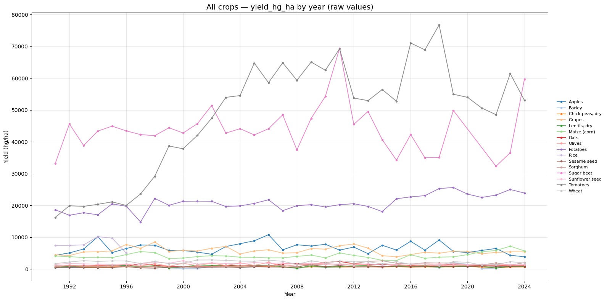

Yield trajectories over the full raw FAO range. Note the drop in 2007–2008,
the collapse in 2011–2012, and the recovery pattern after 2016.

#### 3.7.2 FAOSTAT flag distribution per crop

<!-- TODO: save the figure from 01_eda cell "Flag mix per crop" -->
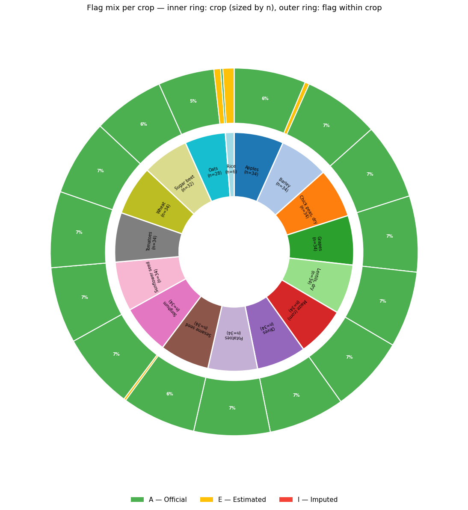

Inner ring shows crop size (number of year observations), outer ring shows
the FAOSTAT flag mix within each crop. Imputed (`I`) values concentrate in
the 2012–2016 conflict years (see §3.6.4, Decision 3).

#### 3.7.3 Filtered crops — 20-year yield view

<!-- TODO: save the figure from 01_eda cell "Regular crops — yield_hg_ha by year" -->
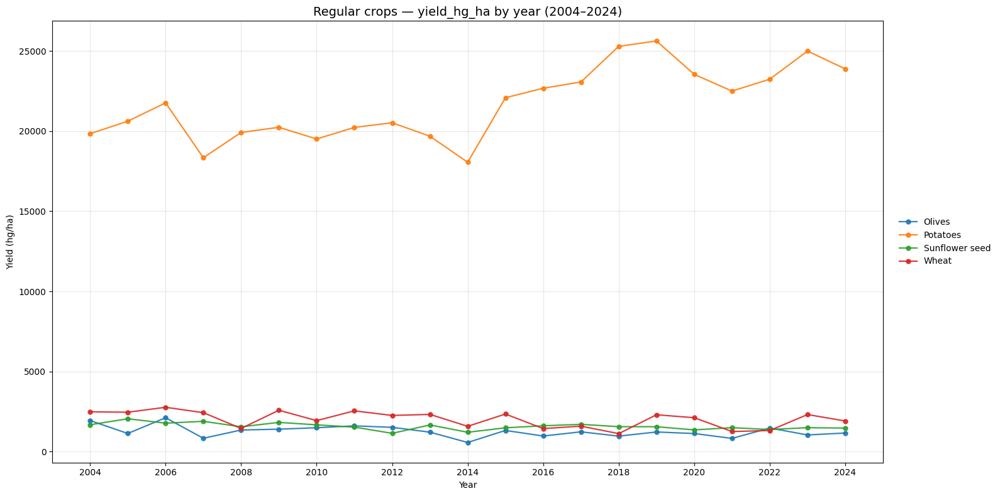

The five crops retained for modeling (Potatoes, Wheat, Maize, Olives,
Sunflower seed) over the last 20 years. This is the modeling target range.

#### 3.7.4 Per-governorate climate anomalies

<!-- TODO: if you want all 13 panels as one figure, save the 13-subplot
     output from cell "All features in one graph per governorate" -->

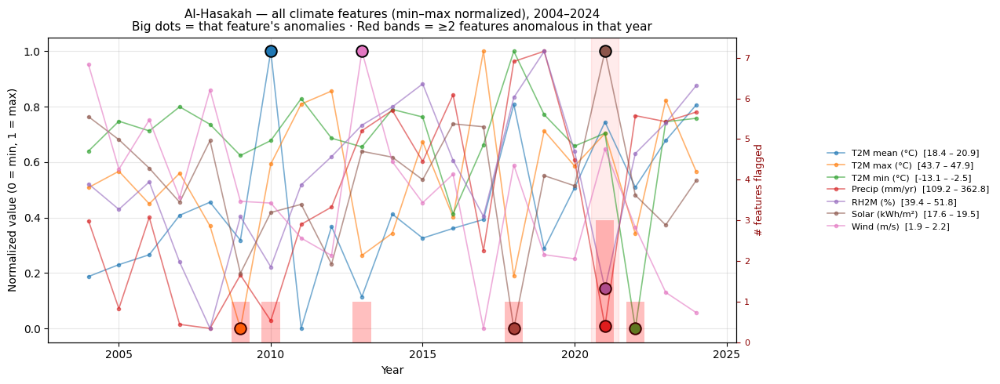

All seven NASA climate features per governorate, min-max normalized, with
per-feature anomalies marked as colored dots. Red bands mark years where ≥ 2
features were flagged simultaneously. (If one combined figure isn't
practical at this size, save one PNG per governorate under
`notebooks/figures/gov_<name>.png` and embed them as a small-multiples grid.)

#### 3.7.5 Combined view — chosen crops vs. all NASA features

<!-- TODO: save the two-panel figure from cell "Combined figure" -->
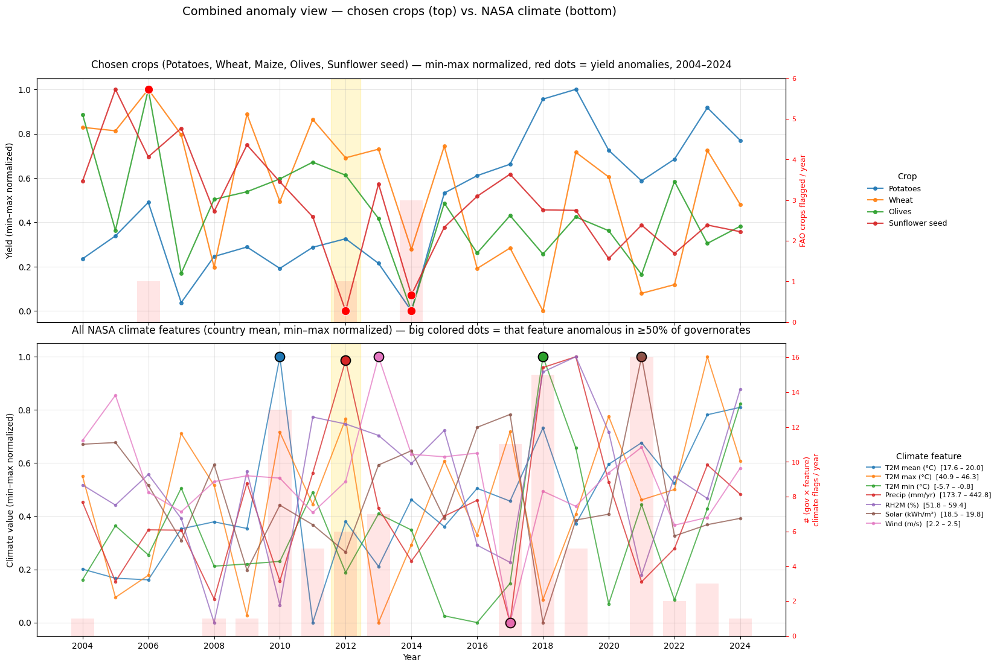

Top panel: the five chosen crops, normalized, with red dots marking yield
anomalies. Bottom panel: all seven NASA features (country mean, normalized),
with per-feature anomaly dots where ≥ 50% of governorates agreed. Gold bands
mark years flagged by **both** datasets — the strongest evidence that
climate and yield anomalies are coupled.

#### 3.7.6 Peak-yield year in climate space (interactive)

<!-- TODO: commit the plotly HTML file -->
[Interactive 3D view: `notebooks/figures/3d_peak_climate_space.html`](notebooks/figures/3d_peak_climate_space.html)

The interactive 3D view (requires `plotly`) shows each crop's peak-yield
year as a colored star in a `(T2M, Solar, Precip)` coordinate system, with
wind speed encoded as marker color. A gray cloud of all years provides
context. Rotate, zoom, and hover in any browser.

## 4. Repository structure

```
ftl-syria-crop-yield/
├── README.md                       ← you are here
├── requirements.txt                ← Python dependencies (full stack)
├── requirements-serve.txt          ← slim deps for Docker/Render
├── config.yaml                     ← defaults for src/data/ingest.py
├── .faostat_token                  ← optional FAOSTAT API token (gitignored)
├── .gitignore
│
├── create-schema.bat / .sh      ← bootstrap: create dirs + placeholders
├── install-deps.bat / .sh       ← install Python deps into .venv
├── track-dvc-git.bat / .sh      ← init DVC, track data/raw, initial commit
│
├── data/
│   ├── raw/                        ← FAO + NASA downloads (DVC-tracked)
│   ├── interim/                    ← train/val/test splits (DVC-tracked)
│   └── processed/                  ← model_table.csv (DVC-tracked)
│
├── src/
│   ├── data/
│   │   ├── ingest.py               ← FAO + NASA downloader (config-driven)
│   │   ├── build_dataset.py        ← clean + join raw → processed
│   │   ├── validate.py             ← schema checks (pandera)
│   │   ├── anomaly_check.py        ← Gaussian + residual z-score flagging
│   │   └── split_dataset.py        ← temporal train/val/test split
│   ├── features/
│   │   └── build_features.py       ← annual/seasonal aggregations
│   ├── models/
│   │   ├── train.py                ← training logic (invoked from root train.py)
│   │   └── evaluate.py             ← metrics + comparison plots
│   └── utils/
│       └── config.py               ← shared config helpers
│
├── train.py                        ← root wrapper: python train.py → saves model.pkl
├── predict.py                      ← FastAPI app: /health, /predict
├── feature_schema.json             ← column contract for serving
│
├── models/
│   ├── model.pkl                   ← final fitted pipeline (COMMITTED to git)
│   └── feature_schema.json         ← (COMMITTED)
│
├── notebooks/
│   └── 01_eda.ipynb                ← EDA + feature importance
│
├── tests/
│   └── test_data_validation.py
│
├── dvc.yaml                        ← pipeline stages
├── params.yaml                     ← hyperparameters
├── Dockerfile
│
└── .github/workflows/              ← (empty for midterm)
```

---

## 5. Prerequisites

- **Python 3.10+** on `PATH` (check with `python --version` or `python3 --version`)
- **Git** (`git --version`)
- **DVC** (`dvc --version` — installed via `requirements.txt`)
- **Docker** (only for the deployment phase)
- **Windows** users: `cmd` or PowerShell; **macOS/Linux** users: any shell

**Free disk space:** at least 2 GB (raw NASA data for 35 years × 13 governorates is ~1 GB).

---

## 6. Quick start (5 commands)

For anyone who just wants to run the pipeline end-to-end:

```bash
# Windows
git clone <repo-url> ftl-syria-crop-yield && cd ftl-syria-crop-yield
create-schema.bat
python -m venv .venv && .venv\Scripts\activate
install-deps.bat
track-dvc-git.bat
```

```bash
# macOS / Linux
git clone <repo-url> ftl-syria-crop-yield && cd ftl-syria-crop-yield
./create-schema.sh
python3 -m venv .venv && source .venv/bin/activate
./install-deps.sh
./track-dvc-git.sh
```

Then ingest data:

```bash
python src/data/ingest.py
```

See [Step-by-step setup](#7-step-by-step-setup) below for full explanations, and [Running the data ingestion](#8-running-the-data-ingestion) for CLI options.

---

## 7. Step-by-step setup

### 7.1 Files you must have before running anything

Two files are **not** generated by the bootstrap scripts. You must have (or create) them at the project root:

#### `requirements.txt`

Lists every Python dependency for the full pipeline. Should already be in the repo. If missing, recreate it:

```text
# ---- Core data & ML ----
pandas>=2.0
numpy>=1.24
scikit-learn>=1.3
xgboost>=2.0
joblib>=1.3

# ---- MLOps stack ----
dvc>=3.0
mlflow>=2.10
pandera>=0.19
pyod>=1.1

# ---- Serving ----
fastapi>=0.110
uvicorn>=0.29
pydantic>=2.0

# ---- Testing ----
pytest>=8.0

# ---- Utilities ----
requests>=2.31
python-dotenv>=1.0
pyyaml>=6.0
```

#### `.faostat_token` (optional)

FAOSTAT's public QCL endpoint works without authentication. If you have a registered API token, paste it into a single-line file at the project root named `.faostat_token`:

```
<your-faostat-token-here>
```

If you don't have one, **skip this file entirely** — `ingest.py` detects its absence and proceeds unauthenticated. The file is `.gitignore`d and never committed.

> **Note on the filename:** earlier drafts of this README mentioned `.fao-token` as shorthand — the actual file that `ingest.py` reads is **`.faostat_token`** (configured via `fao.token_file` in `config.yaml`). Use `.faostat_token`.

#### `config.yaml`

Holds every default value for `ingest.py` (URLs, country code, timeouts, governorates, year range). Should already be committed to the repo. If missing, recreate from the template — every key is documented, and every CLI flag overrides the corresponding config value.

**Do not put secrets in `config.yaml`.** The token lives in `.faostat_token` only.

### 7.2 Bootstrap the project structure

Create the directory tree and placeholder files.

```bat
REM Windows
create-schema.bat
```

```bash
# macOS / Linux
chmod +x create-schema.sh
./create-schema.sh
```

What it does:

- Verifies Python 3.10+ is on `PATH` (exits if not).
- Creates directories: `data/{raw,interim,processed}`, `src/{data,features,models,utils}`, `models`, `metrics`, `notebooks`, `tests`, `.github/workflows`.
- Creates zero-byte placeholder files that later stages fill in (`train.py`, `dvc.yaml`, `01_eda.ipynb`, etc.).
- Seeds `.gitignore` if it doesn't already exist (leaves an existing one untouched).
- Seeds `requirements.txt` if it doesn't already exist.
- Runs `git init` if `.git` is absent.

**Safe to re-run** — the script skips any directory or file that already exists.

### 7.3 Create and activate a virtual environment

```bat
REM Windows
python -m venv .venv
.venv\Scripts\activate
```

```bash
# macOS / Linux
python3 -m venv .venv
source .venv/bin/activate
```

Verify activation succeeded — your shell prompt should be prefixed with `(.venv)`, and `python --version` should report the interpreter inside `.venv`:

```bash
python -c "import sys; print(sys.prefix)"
```

### 7.4 Install dependencies

```bat
REM Windows
install-deps.bat
```

```bash
# macOS / Linux
chmod +x install-deps.sh
./install-deps.sh
```

What it does:

- Verifies `python` is reachable from the **active** environment (fails loudly if you forgot to activate `.venv`).
- Checks whether `requirements.txt` packages are already installed — if so, skips straight to freezing.
- Creates a `.wheel/` cache directory.
- Prefers **offline install** from `.wheel/*.whl` if wheels are present.
- Falls back to `pip download` + offline install if the cache is empty.
- Freezes the environment to `dev-requirements.txt` (exact pinned versions).

Re-running is safe — it detects "already installed" and skips work.

### 7.5 Initialize DVC and make the first commit

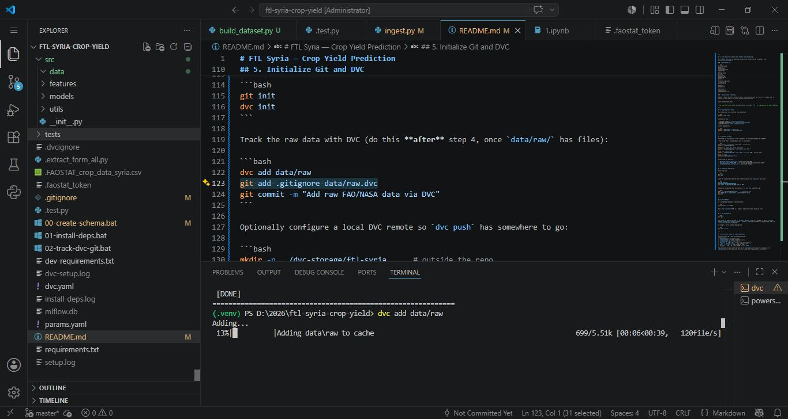

```bat
REM Windows
track-dvc-git.bat
```

```bash
# macOS / Linux
chmod +x track-dvc-git.sh
./track-dvc-git.sh
```

What it does:

- Runs `dvc init --no-scm` if `.dvc/` doesn't already exist.
- Runs `dvc add data/raw` to hash the raw data and write `data/raw.dvc` + `data/raw/.gitignore`.
- `git add .` — stages all changes including the `.dvc` pointer files.
- `git commit -m "chore: initial project bootstrap structure and dvc tracking"` — if there is anything to commit. If not, prints an INFO line and exits cleanly.

**Caution:** `git add .` stages everything not already gitignored. If you have stray files in the working tree, they will be committed. **Run `git status` before trusting the result**, and inspect with `git show --stat HEAD` afterwards.

---

## 8. Running the data ingestion

`src/data/ingest.py` downloads FAOSTAT and NASA POWER data into `data/raw/`. All behavior is controlled by `config.yaml`, and every CLI flag overrides the corresponding config value.

### 8.1 Basic invocations

```bash
# Both sources, full default range (1991 → current year)
python src/data/ingest.py

# Alias — "both" is accepted as a synonym for "all"
python src/data/ingest.py --source all

# FAOSTAT only, custom year range
python src/data/ingest.py --source fao --start-year 2000 --end-year 2024

# NASA only, single year, force re-download
python src/data/ingest.py --source nasa --year 2024 -f

# Point at an alternate config file
python src/data/ingest.py --config config.experiment.yaml

# See all flags
python src/data/ingest.py --help
```

### 8.2 CLI reference

| Flag | Type | Default | Meaning |
|---|---|---|---|
| `--source`, `-s` | `fao` / `nasa` / `all` / `both` | `all` (from config) | Which upstream dataset to download |
| `--year`, `-y` | int | — | Single year (overrides start/end) |
| `--start-year` | int | 1991 (config) | First year of range |
| `--end-year` | int | current year (config if set) | Last year of range |
| `-f`, `--force` | flag | off | Force re-download, overwrite existing files |
| `--config` | path | project root | Path to alternate `config.yaml` |

**Resolution order for every value:** CLI flag → `config.yaml` → in-code fallback.

### 8.3 What lands in `data/raw/`

| File | Generated by | Content |
|---|---|---|
| `QCL_Syria_AllCrops_<year>.csv` | `--source fao` | One file per year, FAOSTAT QCL data for Syria |
| `nasa_daily_<governorate>_<YYYY>_<MM>.csv` | `--source nasa` | One file per (governorate, month) |
| `syria_governorates_reference.csv` | `--source nasa` | 13 governorates, regenerated from `config.yaml` every run |

**Rough size:** FAOSTAT ≈ 1 MB / year. NASA ≈ 50 KB / governorate / month → ~1 GB for 35 years × 13 governorates. Plan accordingly.

### 8.4 What "success" looks like

At the end of a full run, the terminal prints:

```
============================================================
 [DONE]
============================================================
```

For FAOSTAT: `[SUCCESS] QCL_Syria_AllCrops_<year>.csv (<size> bytes)` for each year.

For NASA: `[SUMMARY] NASA: saved=<N> skipped=<M> failed=<K>` — a run is complete when `failed=0`. Transient network errors are retried up to 3 times (`http.max_retries`); a run with `failed>0` is safe to retry with `-f`.

## 9. Configuration

`config.yaml` at the project root holds every default for `src/data/ingest.py`. Full structure:

```yaml
defaults:
  source: "all"            # "fao" | "nasa" | "all"
  start_year: 1991
  end_year: null           # null == use current year (date.today().year)
  output_dir: "data/raw"
  force_redownload: false

http:
  max_retries: 3
  max_debug_bytes: 2000
  faostat_timeout_seconds: 25
  nasa_timeout_seconds: 120
  retry_delay_seconds: 2

fao:
  base_url: "https://faostatservices.fao.org/api/v1/en"
  data_endpoint: "https://faostatservices.fao.org/api/v1/en/data/QCL"
  country_code: "760"      # Syria (M49). See §8.5 for verification.
  output_type: "table"
  token_file: ".faostat_token"

nasa:
  base_url: "https://power.larc.nasa.gov/api/temporal/daily/point"
  community: "AG"
  format: "JSON"
  parameters: [T2M, T2M_MAX, T2M_MIN, PRECTOTCORR, RH2M, ALLSKY_SFC_SW_DWN, WS2M]
  column_mapping:
    T2M: t2m
    T2M_MAX: t2m_max
    T2M_MIN: t2m_min
    PRECTOTCORR: prectotcorr
    RH2M: rh2m
    ALLSKY_SFC_SW_DWN: solar_kwh_m2
    WS2M: ws2m
  fill_value: -999.0

governorates:
  reference_csv: "data/raw/syria_governorates_reference.csv"
  list:
    - {name: Aleppo,      lat: 36.17, lon: 37.61}
    - {name: Al-Hasakah,  lat: 36.42, lon: 40.91}
    - {name: Ar-Raqqah,   lat: 36.01, lon: 38.91}
    - {name: As-Suwayda,  lat: 32.77, lon: 36.92}
    - {name: Daraa,       lat: 32.83, lon: 36.17}
    - {name: Deir ez-Zor, lat: 35.25, lon: 40.28}
    - {name: Hama,        lat: 35.30, lon: 37.25}
    - {name: Homs,        lat: 34.26, lon: 38.16}
    - {name: Idlib,       lat: 35.83, lon: 36.68}
    - {name: Latakia,     lat: 35.57, lon: 36.01}
    - {name: Quneitra,    lat: 33.02, lon: 35.79}
    - {name: Tartus,      lat: 34.95, lon: 36.09}
    - {name: Damascus,    lat: 33.46, lon: 37.05}
```

**The 13 governorates are the authoritative source.** `syria_governorates_reference.csv` is regenerated from this list on every `--source nasa` run, so edit the list here — not the CSV — if you ever need to change geography.

**Freezing the end year for reproducibility:** leaving `end_year: null` means every run downloads through the current year. For the midterm submission, set an explicit value (e.g., `end_year: 2025`) so a reviewer re-running the ingestion gets the exact same dataset you trained on. Document the change in the commit message.

---

## 10. DVC workflow

DVC tracks the actual data files. Git tracks the DVC pointer files (`.dvc`). This keeps large CSVs out of Git while preserving exact reproducibility.

### 10.1 After ingestion, track `data/raw/` with DVC

```bash
dvc add data/raw/
git add data/raw.dvc data/raw/.gitignore
git commit -m "data(raw): add FAO + NASA source files via DVC"
```

### 10.2 Track processed and interim data

```bash
# After running build_dataset.py
dvc add data/processed/
git add data/processed.dvc data/processed/.gitignore
git commit -m "data(processed): add clean model table via DVC"

# After running split_dataset.py
dvc add data/interim/
git add data/interim.dvc data/interim/.gitignore
git commit -m "data(interim): add temporal train/val/test splits via DVC"
```

### 10.3 Configure a DVC remote and push

`dvc push` sends the actual data to a remote — local folder, S3, GDrive, SSH. Pick one:

```bash
# Local folder (simplest for solo work)
mkdir -p ../dvc-storage/ftl-syria
dvc remote add -d storage ../dvc-storage/ftl-syria

# Or S3
dvc remote add -d storage s3://your-bucket/ftl-syria

git add .dvc/config
git commit -m "chore(dvc): configure remote storage"
dvc push
```

### 10.4 Rehydrate on a fresh clone

```bash
git clone <repo-url> ftl-syria-crop-yield && cd ftl-syria-crop-yield
dvc pull
```

**If no DVC remote is configured,** reviewers can instead re-download the raw data:

```bash
python src/data/ingest.py
```

## 11. Modeling and training

Two scripts produce the served models. Both read configuration from
**`config.yaml`** under the `training:` key — you never edit Python to
change a hyperparameter, a split boundary, or a feature list.

| Step | Script | What it does |
|---|---|---|
| 1. Split | `src/data/split_dataset.py` | Joins FAO yields with NASA climate (averaged to national level), drops partial years, writes `data/interim/{train,val,test}.csv` |
| 2. Train | `train.py` | Trains DecisionTree + XGBoost per crop, saves `models/{dt,xgb}_<crop>.pkl`, writes `models/feature_schema.json` and `models/training_summary.json` |
| 3. Serve | `predict.py` | FastAPI service — loads models lazily, exposes UI + API |


### 11.1 Configuration (`config.yaml` → `training:`)

```yaml
training:
  feature_cols:                  # passed to the model, in this order
    - "t2m_mean"
    - "t2m_max_extreme"
    - "t2m_min_extreme"
    - "precip_total"
    - "rh2m_mean"
    - "solar_mean"
    - "ws2m_mean"
  anomaly_features:              # optional anomaly indicators
    - "yield_anomaly"
    - "drought_year"
    - "conflict_year"
    - "climate_anomaly"
  target: "yield_hg_ha"

  split:                         # used by split_dataset.py
    train_end:   2015            # years ≤ 2015 → train
    val_end:     2019            # 2016–2019 → val
    test_end:    2024            # 2020–2024 → test
    drop_years_from: 2026        # drop partial / current-year rows

  model_types:                   # served families (used by predict.py)
    - "dt"
    - "xgb"
  default_model_type: "dt"

  best_params:                   # per-crop tuned hyperparameters
    Wheat:
      dt:  {max_depth: 3, min_samples_leaf: 2, min_samples_split: 2, ccp_alpha: 0.0}
      xgb: {n_estimators: 50, max_depth: 2, learning_rate: 0.05, subsample: 0.8, colsample_bytree: 0.8, min_child_weight: 3}
    Potatoes: { ... }
    # ... one entry per crop; crops omitted fall back to default_params

  default_params:                # fallback when a crop has no override
    dt:  {max_depth: 3, min_samples_leaf: 2, min_samples_split: 2, ccp_alpha: 0.0}
    xgb: {n_estimators: 50, max_depth: 2, learning_rate: 0.05, subsample: 0.8, colsample_bytree: 0.8, min_child_weight: 3}

  models_dir: "models"
  log_file:   "models/train.log"
```

### 11.2 Prepare the splits

```bash
python -u src/data/split_dataset.py -f
```

Produces:

```
data/interim/train.csv
data/interim/val.csv
data/interim/test.csv
data/interim/split_metadata.json
```

`split_metadata.json` records the year boundaries, row counts, and the exact
feature list — a reviewer can inspect it without running the script.

### 11.3 Train the models

Model training is driven by **`notebooks/02_models.ipynb`**. That notebook connects to a
local MLflow tracking server, loads the train/val/test splits produced earlier, and
trains a **Decision Tree Regressor** and an **XGBoost Regressor** for each crop using
grid-search hyper-parameter tuning. The winning hyper-parameters are then copied into
the project YAML (`conf/train.yaml`) so the pipeline can be reproduced head-less.

#### 11.3.1 Prerequisites

An MLflow server must be running before the notebook is executed. Start it once in a
separate shell:

```bash
mlflow server --port 5000
```
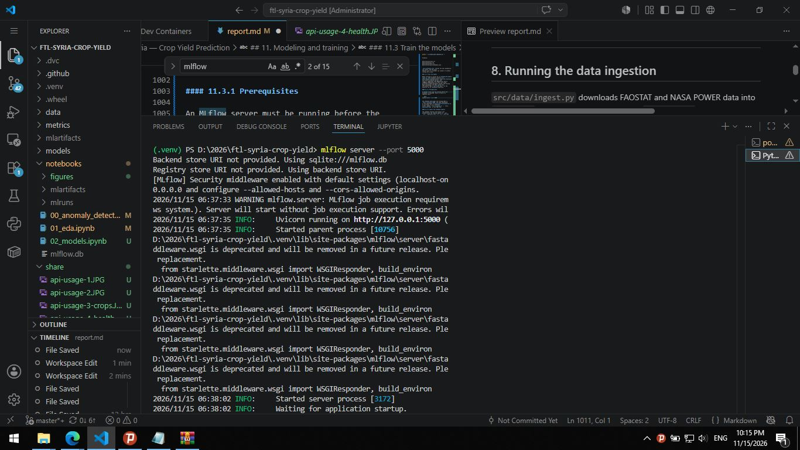

The notebook hard-codes the tracking URI to `http://localhost:5000` and logs everything
to the experiment **`Syria_Crop_Yield_Baseline`**. If you point it at a different
server, update `train.tracking_uri` / `train.experiment_name` in the YAML too.

#### 11.3.2 Inputs the notebook expects

The notebook resolves the project root automatically (by looking upward for `.git`,
`.dvc`, `pyproject.toml`, or `src/`) and then reads from `data/interim/`:

| File | Purpose |
|---|---|
| `train.csv` | Used for fitting + cross-validation |
| `val.csv` | Early stopping / early stopping eval set |
| `test.csv` | Held-out reporting only |
| `split_metadata.json` | Provides `feature_columns` and `target` |

From `split_metadata.json` the notebook derives:

- **`FEATURES`** = `['t2m_mean', 't2m_max_extreme', 't2m_min_extreme', 'precip_total', 'rh2m_mean', 'solar_mean', 'ws2m_mean']`
- **`TARGET`** = `yield_hg_ha`

After loading, two combined views are built:

```python
X_train_full = pd.concat([train[FEATURES], val[FEATURES]])
y_train_full = pd.concat([train[TARGET], val[TARGET]])
```

`X_train_full` / `y_train_full` are what the **final** refit uses; the un-concatenated
`X_train` / `X_val` are kept for early stopping and CV.

#### 11.3.3 The two model families

The notebook trains **two baselines** first (to record an un-tuned reference in MLflow),
then a **grid-search-tuned** version of each, then refits the winner on `train + val`.

**Baseline Decision Tree** (`dt_params`)

```python
dt_params = {
    "max_depth": 6,
    "min_samples_leaf": 3,
    "random_state": 42,
}
```

**Baseline XGBoost** (`xgb_params`)

```python
xgb_params = {
    "objective": "reg:squarederror",
    "eval_metric": "rmse",
    "max_depth": 3,
    "learning_rate": 0.1,
    "n_estimators": 200,
    "subsample": 0.9,
    "colsample_bytree": 0.9,
    "tree_method": "hist",
    "random_state": 42,
}
```

> These two dicts are copied verbatim into the YAML under
> `train.baselines.decision_tree` and `train.baselines.xgboost`.

#### 11.3.4 Hyper-parameter search ("advanced ML" step)

For **every crop**, the notebook runs a `GridSearchCV` with `KFold(5, shuffle=True,
random_state=42)` and `scoring="neg_root_mean_squared_error"`. A nested MLflow run
(`GridSearch_<Family>_<Crop>`) stores the full trial table as a CSV artifact so the
search is auditable later.

**Decision-Tree grid**

```python
param_grid = {
    "max_depth":         [2, 3, 4, 5, 6, None],
    "min_samples_leaf":  [1, 2, 3, 5],
    "min_samples_split": [2, 4, 6],
    "ccp_alpha":         [0.0, 0.001, 0.01, 0.1],
}
```

**XGBoost grid** (kept conservative on purpose — ~20 rows/crop)

```python
param_grid = {
    "n_estimators":     [50, 100, 200],
    "max_depth":        [2, 3, 4],
    "learning_rate":    [0.01, 0.05, 0.1],
    "subsample":        [0.8, 1.0],
    "colsample_bytree": [0.8, 1.0],
    "min_child_weight": [1, 3],
}
```

After the search the notebook prints a summary like:

```text
Best params: {'max_depth': 2, 'min_samples_leaf': 2, ...}
CV RMSE (5-fold on train): 413.39
run_id = 3e293e06f0574b069fbd31974b4576d1
```

**Those three lines are exactly the values that get copied into the YAML** for the crop.

#### 11.3.5 Final fit and what gets logged

The best estimator is **refit on `train + val`**, then evaluated on train/val/test.
Per split, MLflow records:

| Metric | Meaning |
|---|---|
| `{split}_rmse` | Root mean squared error |
| `{split}_mae` | Mean absolute error |
| `{split}_r2` | Coefficient of determination |
| `{split}_smape` | Symmetric MAPE (bounded 0–200) |
| `{split}_rmse_ratio` | `rmse / mean(actual)` — unit-free, cross-crop comparable |
| `{split}_mae_ratio` | `mae / mean(actual)` |
| `n_train`, `n_val`, `n_test`, `n_train_full` | Row counts |
| `cv_folds`, `best_cv_rmse` | CV metadata |

The fitted model is persisted with `mlflow.sklearn.log_model` under
**`decision_tree_<crop_slug>`** / **`xgboost_<crop_slug>`**, where
`crop_slug = crop.lower().replace(' ', '_')` (e.g. `maize_(corn)`).
`skops` is attempted first; on failure the notebook falls back to
`serialization_format="cloudpickle"` (XGBoost always falls back, because
`xgboost.core.Booster` is flagged as untrusted by skops).

A post-save sanity check does `load_model(f"runs:/{run_id}/…")` and predicts one
row, so a green `[OK] Model reloads and predicts` line means the artifact is
usable.

#### 11.3.6 YAML contract

The notebook is the **source of truth** for hyper-parameters; the YAML simply
mirrors the results so the training script can run without the notebook. For each
crop the config block looks like:

```yaml
models:
  Wheat:
    decision_tree:
      max_depth: 2
      min_samples_leaf: 2
      min_samples_split: 2
      ccp_alpha: 0.0
      random_state: 42
      cv_rmse: 413.39
      run_id: "3e293e06f0574b069fbd31974b4576d1"

    xgboost:
      n_estimators: 100
      max_depth: 3
      learning_rate: 0.01
      subsample: 1.0
      colsample_bytree: 1.0
      min_child_weight: 1
      cv_rmse: 355.17
      run_id: "6fc02695fb224b208d2f13653b56c217"
```

- **Every key before `cv_rmse`** goes straight into the estimator constructor
  (`DecisionTreeRegressor(**params)` / `XGBRegressor(**params)`).
- **`cv_rmse`** and **`run_id`** are metadata: they let you compare crops and
  reload the exact artifact with `runs:/{run_id}/…` without touching the registry.
- The keys must match the search grid exactly — if you add `ccp_alpha` to the
  grid, keep it in the YAML, even when the winner is `0.0`.

#### 11.3.7 Results obtained so far

Best-params and CV RMSE for the crops for which the notebook has fully run:

| Crop | DTR best params | DTR CV RMSE | XGB best params | XGB CV RMSE | Winner |
|---|---|---|---|---|---|
| Wheat | `max_depth=2, min_samples_leaf=2, min_samples_split=2, ccp_alpha=0.0` | 413.39 | `n_estimators=100, max_depth=3, lr=0.01, subsample=1.0, colsample=1.0, min_child_weight=1` | **355.17** | XGBoost |
| Maize (corn) | `max_depth=5, min_samples_leaf=2, min_samples_split=6, ccp_alpha=0.0` | 653.76 | `n_estimators=50, max_depth=2, lr=0.01, subsample=1.0, colsample=1.0, min_child_weight=3` | **591.55** | XGBoost |
| Olives | `max_depth=2, min_samples_leaf=5, min_samples_split=2, ccp_alpha=0.0` | 527.96 | `n_estimators=50, max_depth=3, lr=0.01, subsample=0.8, colsample=0.8, min_child_weight=3` | **407.47** | XGBoost |
| Potatoes | *(not yet tuned — notebook truncated)* | — | *(not yet tuned)* | — | — |

**XGBoost wins every completed crop.** Its best configs consistently favour
`learning_rate=0.01` with shallow trees (`max_depth` 2–3) and 50–100 estimators,
which is exactly what you'd expect on ~25 samples/crop: strong regularisation
beats capacity.

#### 11.3.8 Outstanding work

1. **Potatoes** — re-run the `#### Grid Search + KFold CV` and `### XGB` cells and
   paste the printed `Best params` / `CV RMSE` / `run_id` into the YAML.
2. **11 remaining crops** — the dataset defines 15 crops
   (`Apples, Barley, Chick peas (dry), Grapes, Lentils (dry), Oats, Sesame seed,
   Sorghum, Sugar beet, Sunflower seed, Tomatoes`) but only four are present in the
   notebook. Duplicate the per-crop block (`CROP = "…"` → DTR → XGB) for each.
3. **Promotion** — once all 15 crops have a winner, the training script should
   read `train.models.<Crop>.xgboost`, instantiate it, and load the artifact by
   `run_id` rather than re-fitting (or re-fit for a fresh local run — both are
   valid, just pick one policy).

##### Why these details matter

| Detail | Reason it earns its place in 11.3 |
|---|---|
| **Prerequisites / `mlflow server`** | Without this the notebook fails at cell 2; anyone re-running 11.3 needs the exact command |
| **Inputs table** | Makes the notebook reproducible without reading the code — you know exactly which CSVs and JSON are required |
| **`X_train_full` vs `X_train`** | This is a real design decision (CV uses train only, final refit uses train+val). Silent bugs creep in if a reader assumes they're the same |
| **Baseline vs tuned params** | Explains *why* the YAML has two sections (`baselines` + `models`) rather than one |
| **Grid definitions** | The YAML keys must match grid keys 1-to-1; spelling them out prevents drift when someone edits one side |
| **Metric table** | Tells downstream consumers (dashboards, model registry) which keys to expect in MLflow — including `rmse_ratio`, which is what you actually compare across crops |
| **Artifact naming convention** | The `crop_slug` rule (`lower().replace(' ', '_')`) is non-obvious — `Maize (corn)` becomes `maize_(corn)`. Without this, `load_model` calls silently miss |
| **`skops` → `cloudpickle` fallback** | XGBoost *always* triggers the fallback; new readers will see the `[WARN]` line and worry. Documenting it turns noise into expected behaviour |
| **YAML contract** | Separates *constructor params* from *metadata* (`cv_rmse`, `run_id`) — critical when someone writes a `**params` loop and accidentally passes `run_id` to the constructor |
| **Results table** | The three-point "XGBoost beats DTR on every crop, prefers `lr=0.01` + shallow trees" pattern is the actual insight — without it 11.3 is just plumbing |
| **Outstanding work** | Potatoes truncation and 11 missing crops are *known gaps*. Flagging them explicitly stops the next person from assuming the YAML is complete |

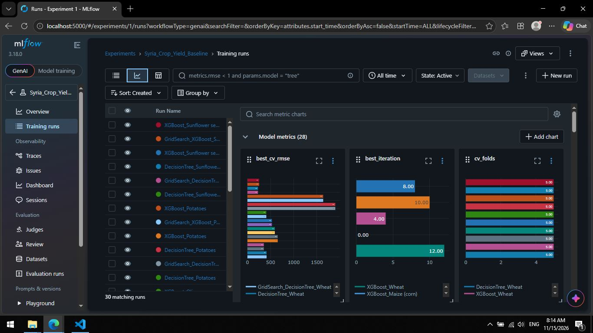
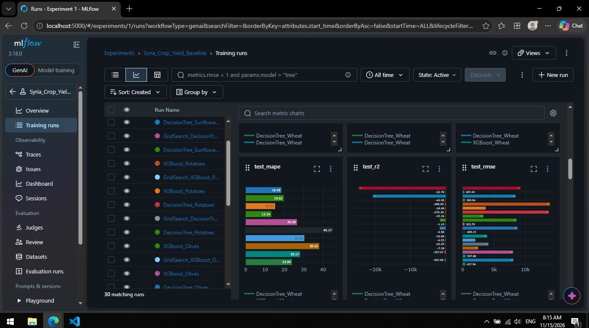
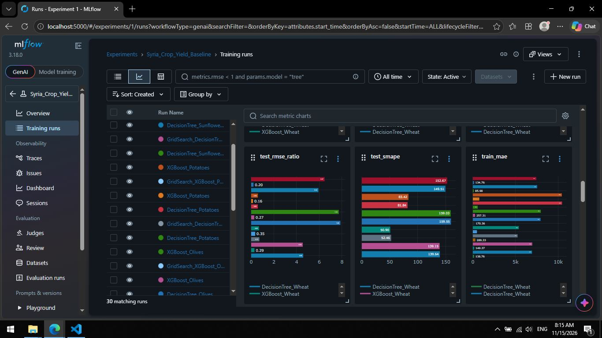
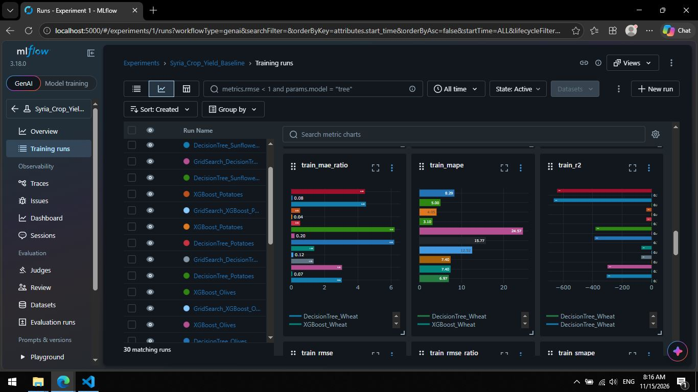
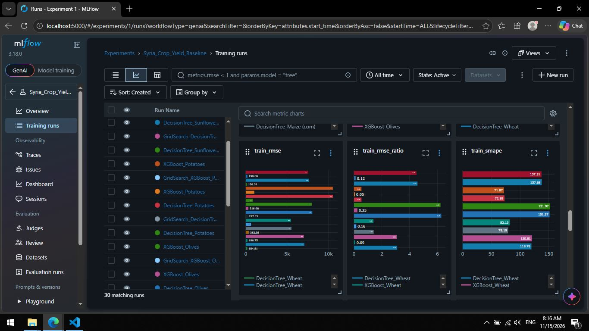
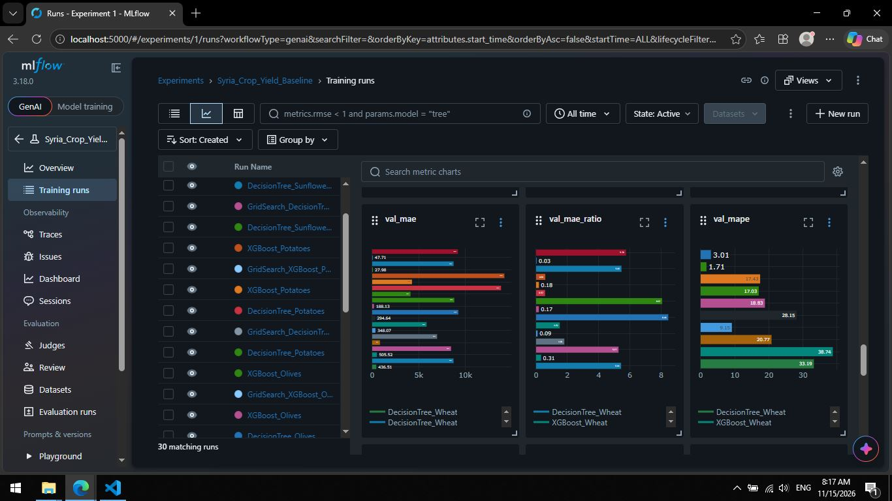
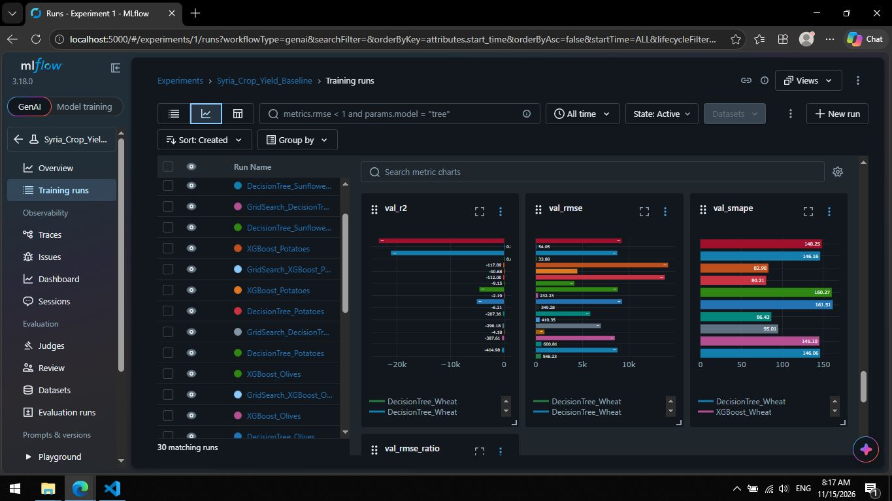

## 11.3.9 Train on product 

- To train at prodcution time you can just run the commands:

```bash
# All crops, both model families
python train.py

# One crop, both families
python train.py --crop Wheat

# All crops, XGBoost only
python train.py --model xgb

# One crop, one family
python train.py --crop Wheat --model dt

# Also log every run to MLflow (optional)
python train.py --mlflow
```

**What `train.py` reads and writes:**

| Reads | Writes |
|---|---|
| `config.yaml` (`training.*`) | `models/dt_<crop>.pkl` — 15 files |
| `data/interim/train.csv` | `models/xgb_<crop>.pkl` — 15 files |
| `data/interim/val.csv` | `models/feature_schema.json` — the API contract |
| `data/interim/test.csv` | `models/training_summary.json` — all metrics |
| | `models/train.log` — append-only session log |

**Crops currently trained (15):**

```
Apples, Barley, Chick peas (dry), Grapes, Lentils (dry), Maize (corn),
Oats, Olives, Potatoes, Sesame seed, Sorghum, Sugar beet, Sunflower seed,
Tomatoes, Wheat
```

Each has both a `dt` and an `xgb` model — 30 `.pkl` files total. Every crop
in `data/interim/train.csv` is trained automatically; you don't maintain a
separate crop list in code.

**Feature order matters.** `train.py` writes `feature_schema.json` with the
**exact training column order** (not alphabetized). XGBoost raises
`feature_names mismatch` if the prediction DataFrame uses a different order —
the schema is the single source of truth that both `train.py` and `predict.py`
agree on.

### 11.4 `train.py` CLI reference

| Flag | Default | Meaning |
|---|---|---|
| `--crop <Name>` | all crops in the train split | Train only this crop |
| `--model {dt,xgb,both}` | `both` | Which model family |
| `--mlflow` | off | Also log runs to MLflow |
| `--log-file <path>` | `models/train.log` | Append log destination |
| `--reset-log` | off | Truncate the log file before starting |

Exit code is `0` when all requested models trained, `1` when any were skipped
(not enough rows, empty split, etc.). Skipped models are listed in both the
log and the console output.

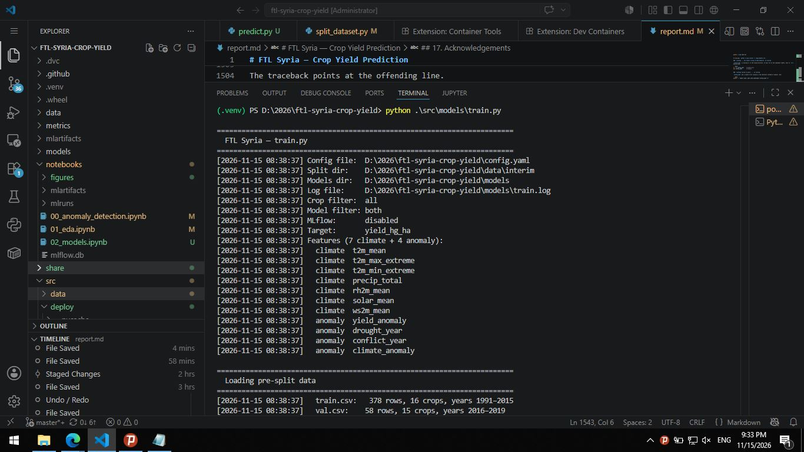

### 11.5 Monitoring training — `models/train.log`

Every `python train.py` invocation **appends** to `models/train.log`. Nothing
is overwritten — the full history is preserved, with a `SESSION START`
separator between runs. The log is gitignored (local history only); the
committed record is `models/training_summary.json`.

**Sample log line per model:**

```
[2026-11-15 10:30:45]   [dt] saved → models\dt_wheat.pkl
[2026-11-15 10:30:45]   [dt] params: {'max_depth': 3, 'min_samples_leaf': 2, ...}
[2026-11-15 10:30:45]   [dt] n = 20 train / 4 val / 5 test
[2026-11-15 10:30:45]   [dt] train  rmse=  234.12  mae=  198.45  r2=  0.912  smape=  11.23
[2026-11-15 10:30:45]   [dt] val    rmse=  412.34  mae=  355.12  r2=  0.342  smape=  18.45
[2026-11-15 10:30:45]   [dt] test   rmse=  398.21  mae=  340.88  r2=  0.388  smape=  17.92
[2026-11-15 10:30:45]   [dt] top importances: precip_total=0.42, t2m_max_extreme=0.28, ...
```

**Useful greps:**

```bash
grep "SESSION START" models/train.log              # list runs
grep "\[dt\].*test " models/train.log | grep Wheat # DT test on Wheat
grep "\[xgb\].*val " models/train.log               # all XGB val metrics
grep "SKIPPED" models/train.log                     # anything skipped
```

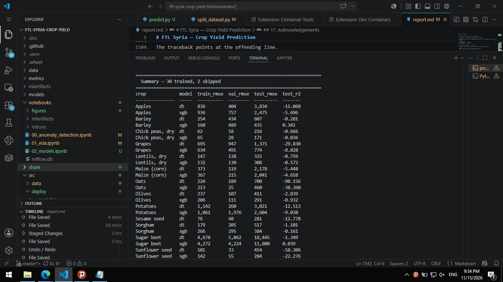

### 11.6 Verify a training run

```bash
# 1. Schema was written correctly
python -c "import json; print(json.load(open('models/feature_schema.json'))['feature_cols'])"
# → ['t2m_mean', 't2m_max_extreme', 't2m_min_extreme',
#    'precip_total', 'rh2m_mean', 'solar_mean', 'ws2m_mean',
#    'yield_anomaly', 'drought_year', 'conflict_year', 'climate_anomaly']

# 2. Schema order matches the model's internal order
python -c "
import json, joblib
s = json.load(open('models/feature_schema.json'))['feature_cols']
m = joblib.load('models/xgb_wheat.pkl').get_booster().feature_names
print('match:', s == list(m))
"
# → match: True

# 3. Models list from the schema
python -c "import json; s = json.load(open('models/feature_schema.json')); print(len(s['crops']), 'crops:', s['crops'])"
# → 15 crops: ['Apples', 'Barley', 'Chick peas, dry', ...]
```

If step 2 prints `match: False`, re-run `python train.py` — the fix is
deterministic (schema is always written in `FEATURE_COLS + ANOMALY_FEATURES`
order).

### 11.7 Model selection summary

All 15 crops have both a `dt` and an `xgb` model available. The API lets the
client choose which family to use per request (see §13). Full per-crop
metrics are in `models/training_summary.json`. A quick comparison:

```bash
python -c "
import json
s = json.load(open('models/training_summary.json'))
for m in s:
    if 'skipped' in m: continue
    rmse = m['metrics']['test_rmse']; r2 = m['metrics']['test_r2']
    print(f\"{m['crop']:<20} {m['family']:<4} test_rmse={rmse:>10,.1f}  test_r2={r2:>6.3f}\")
"
```

**Honest caveat:** with ~20 training rows per crop, per-crop models are
data-limited — the pooled model (all crops in one model, `crop` one-hot
encoded) generalizes better and is what the research question is answered
with. The per-crop models here are the **serving** models — they let a user
ask "given this climate, what is the yield of Wheat?" and get a crop-specific
answer.


## 12. Serving the model

`predict.py` is a **FastAPI** service with three simultaneous frontends on
the same process:

| Endpoint | What it is | Use case |
|---|---|---|
| `GET /` | HTML form | Human reviews, quick demo |
| `GET /docs` | Swagger UI (auto) | Interactive API testing |
| `POST /predict` | JSON API | `curl`, scripts, another service |

All three call the same prediction logic — no duplication.

### 12.1 Start the service

```bash
uvicorn predict:app --host 0.0.0.0 --port 9696
```

Or via the script itself (uses `PORT` env var if set, else `9696`):

```bash
python predict.py
```

At startup, the log prints what was loaded:

```
[startup] schema: .../models/feature_schema.json
[startup] crops:  ['Apples', 'Barley', ..., 'Wheat']  (15 crops)
[startup] models: {'Wheat': {'dt': 'dt_wheat.pkl', 'xgb': 'xgb_wheat.pkl'}, ...}
[startup] feature defaults (from train.csv): {'t2m_mean': 18.17, ...}
[startup] preloaded 30 models
```

**`preloaded N models` confirms every `.pkl` loaded successfully.** If any
are missing, the log shows a `[warn] preload <crop>/<family> failed` line and
that `(crop, family)` returns 404 on request — other models still work.

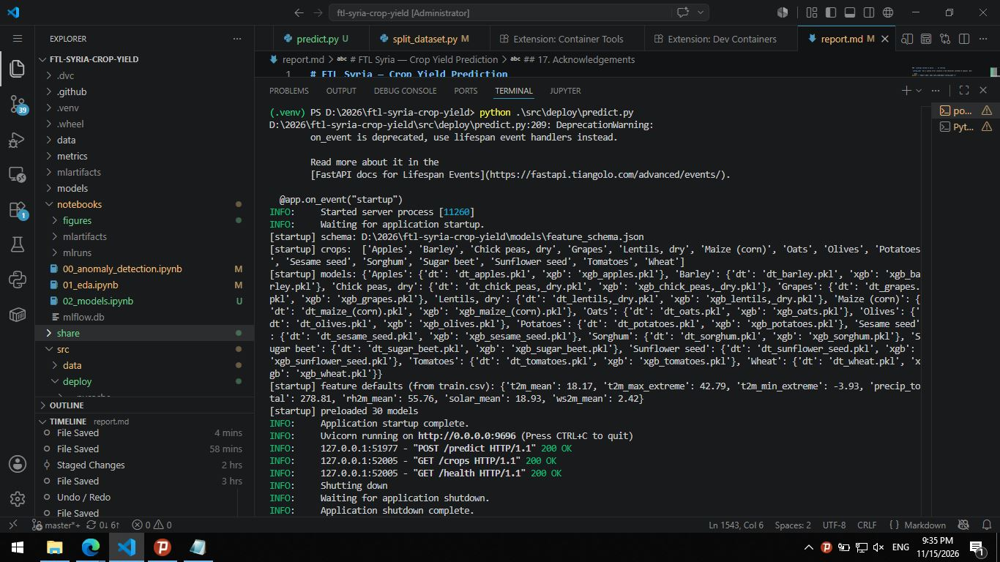

### 12.2 `predict.py` CLI / env vars

| Env var | Default | Effect |
|---|---|---|
| `PORT` | 9696 | Listening port (Render sets this automatically) |

Config-driven (via `config.yaml` `training:` and `serving:`):

| Key | Default | Effect |
|---|---|---|
| `training.model_types` | `["dt", "xgb"]` | Allowed `model` values in requests |
| `training.default_model_type` | `"dt"` | Used when the request omits `model` |
| `training.models_dir` | `"models"` | Where `.pkl` files are read from |
| `serving.title` | "FTL Syria — Crop Yield Prediction" | Page title / API title |


### 12.3 What `predict.py` validates

| Check | Response |
|---|---|
| Unknown `crop` | `404` with list of valid crops |
| Unknown `model` family | `400` with allowed families |
| Missing feature keys | `422` listing which keys are absent |
| Extra feature keys | `422` listing which keys are unknown |
| Non-numeric feature value | `422` with the offending key |
| `.pkl` file missing on disk | `404` telling you to re-run `train.py` |

All error responses are JSON: `{"detail": "..."}` — see §13.3 for examples.

---

## 13. Using the API

Three ways to interact with a running service. Pick the one that matches
how you want to test it.

### 13.1 Web UI — `http://localhost:9696/`

Open a browser. You get:

- **Crop dropdown** — all 15 trained crops
- **Model dropdown** — `dt` (DecisionTree) or `xgb` (XGBoost)
- **Feature inputs** — one number box per feature, **pre-filled with the
  training-set means**
- **Predict button** — submits and shows the result in a result box below

**Default pre-fill values** (from `data/interim/train.csv` at startup):

| Feature | Mean |
|---|---|
| `t2m_mean` | 18.17 °C |
| `t2m_max_extreme` | 42.79 °C |
| `t2m_min_extreme` | -3.93 °C |
| `precip_total` | 278.81 mm/year |
| `rh2m_mean` | 55.76 % |
| `solar_mean` | 18.93 kWh/m² |
| `ws2m_mean` | 2.42 m/s |

These are **realistic national averages** — clicking "Predict" without
editing anything returns a plausible number (e.g., ~2,000–2,500 hg/ha for
Wheat) rather than a nonsense value from zeros.

**To test different crops or years:**
1. Change the crop dropdown
2. Optionally change the model dropdown (compare `dt` vs. `xgb` on the same
   input)
3. Adjust any feature values to simulate a specific climate year
4. Click **Predict** — the result appears with a caption showing which crop
   and model were used

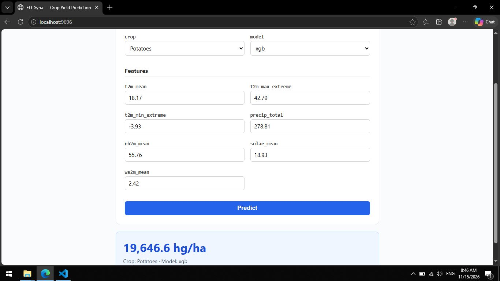

### 13.2 Swagger UI — `http://localhost:9696/docs`

FastAPI auto-generates an interactive API documentation page. Every endpoint
is listed with:

- A description
- Required/optional parameters
- The exact request/response schema
- A **"Try it out"** button that opens a form pre-filled with an example
  body

**To test a prediction:**
1. Click `POST /predict` → **Try it out**
2. Edit the JSON body (e.g., change `"crop": "Wheat"` to `"crop": "Maize (corn)"`)
3. Click **Execute** — you see the response code, headers, and body

This is the fastest way to exercise edge cases (unknown crop, missing
feature, invalid model) without writing `curl` commands.

Also see `http://localhost:9696/redoc` for a cleaner read-only view of the
API.

### 13.3 JSON API — `POST /predict`

Programmatic access. Any HTTP client works — `curl`, Python `requests`,
Postman, another service.

**Sample request body** (save as `sample_request.json`):

```json
{
  "crop": "Wheat",
  "model": "xgb",
  "features": {
    "t2m_mean": 18.4,
    "t2m_max_extreme": 42.8,
    "t2m_min_extreme": -3.9,
    "precip_total": 312.4,
    "rh2m_mean": 58.2,
    "solar_mean": 18.9,
    "ws2m_mean": 3.1,
    "yield_anomaly": 0,
    "drought_year": 0,
    "conflict_year": 0,
    "climate_anomaly": 1
  }
}
```

**Send it:**

```bash
curl -X POST http://localhost:9696/predict \
  -H "Content-Type: application/json" \
  -d @sample_request.json
```

**Successful response (200):**

```json
{
  "crop": "Wheat",
  "model": "xgb",
  "predicted_yield_hg_ha": 1842.7,
  "input_features": {
    "t2m_mean": 18.4,
    "t2m_max_extreme": 42.8,
    "t2m_min_extreme": -3.9,
    "precip_total": 312.4,
    "rh2m_mean": 58.2,
    "solar_mean": 18.9,
    "ws2m_mean": 3.1,
    "yield_anomaly": 0,
    "drought_year": 0,
    "conflict_year": 0,
    "climate_anomaly": 1
  }
}
```

**Python example:**

```python
import requests

payload = {
    "crop": "Maize (corn)",
    "model": "dt",
    "features": {
        "t2m_mean": 19.5,
        "t2m_max_extreme": 40.1,
        "t2m_min_extreme": -1.2,
        "precip_total": 250.0,
        "rh2m_mean": 52.0,
        "solar_mean": 19.2,
        "ws2m_mean": 2.5,
        "yield_anomaly": 0,
        "drought_year": 0,
        "conflict_year": 0,
        "climate_anomaly": 0,
    },
}
r = requests.post("http://localhost:9696/predict", json=payload)
print(r.json())
```

**Compare DTR vs. XGBoost on the same input:**

```bash
for m in dt xgb; do
  curl -s -X POST http://localhost:9696/predict \
    -H "Content-Type: application/json" \
    -d "{\"crop\":\"Wheat\",\"model\":\"$m\",\"features\":{...}}" \
    | python -c "import sys, json; d = json.load(sys.stdin); print(f\"{d['model']}: {d['predicted_yield_hg_ha']:.1f} hg/ha\")"
done
```

### 13.4 Other endpoints

| Endpoint | Returns |
|---|---|
| `GET /health` | `{"status": "ok", "models_loaded": 30}` |
| `GET /crops` | `{"crops": [...15...], "model_types": ["dt","xgb"], "default_model_type": "dt", "models": {...}}` |
| `GET /schema` | The full `models/feature_schema.json` |

`GET /crops` is useful for a client to discover what's available before
sending a prediction.

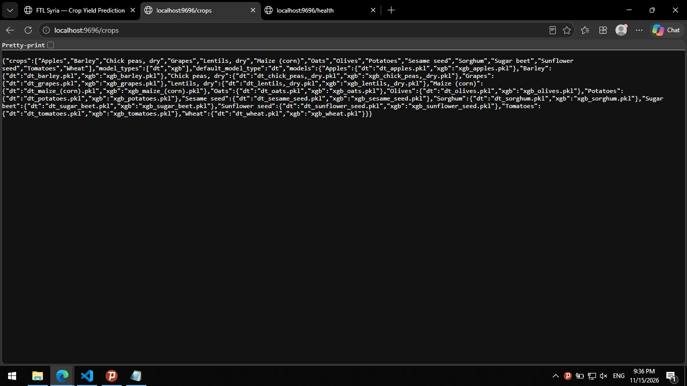
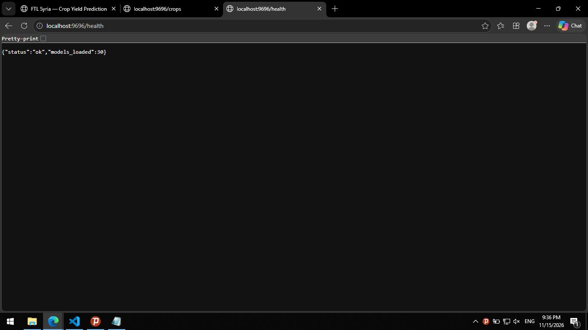


### 13.5 Error responses

Every error returns JSON `{"detail": "..."}` with a clear message. Common cases:

**Unknown crop (404):**

```bash
curl -X POST http://localhost:9696/predict \
  -H "Content-Type: application/json" \
  -d '{"crop": "Banana", "model": "dt", "features": {}}'
```
```json
{"detail": "Unknown crop 'Banana'. Available: ['Apples', 'Barley', ..., 'Wheat']"}
```

**Unknown model family (400):**

```bash
curl -X POST http://localhost:9696/predict \
  -H "Content-Type: application/json" \
  -d '{"crop": "Wheat", "model": "lstm", "features": {}}'
```
```json
{"detail": "Unknown model 'lstm'. Allowed: ['dt', 'xgb']"}
```

**Missing features (422):**

```bash
curl -X POST http://localhost:9696/predict \
  -H "Content-Type: application/json" \
  -d '{"crop": "Wheat", "model": "dt", "features": {"t2m_mean": 18}}'
```
```json
{"detail": "Missing feature(s): ['climate_anomaly', 'conflict_year', 'drought_year', 'precip_total', 'rh2m_mean', 'solar_mean', 't2m_max_extreme', 't2m_min_extreme', 'ws2m_mean', 'yield_anomaly']"}
```

**Extra features (422):**

```bash
curl -X POST http://localhost:9696/predict \
  -H "Content-Type: application/json" \
  -d '{"crop": "Wheat", "model": "dt", "features": {"t2m_mean": 18, "temperature": 20, ...}}'
```
```json
{"detail": "Unexpected feature(s): ['temperature']"}
```

**Model file missing (404):**

If `models/xgb_sorghum.pkl` was deleted but `feature_schema.json` still
mentions it, requests for `crop=Sorghum, model=xgb` return:

```json
{"detail": "Model file not found: .../models/xgb_sorghum.pkl. Re-run: python train.py --crop Sorghum --model xgb"}
```

### 13.6 Model families at runtime

The `model` field in `POST /predict` selects which trained model to use:

| `model` value | What it uses |
|---|---|
| `"dt"` | DecisionTreeRegressor for that crop |
| `"xgb"` | XGBoostRegressor for that crop |
| omitted / `null` | Falls back to `config.yaml` `default_model_type` (default `"dt"`) |

The allowed values come from `config.yaml` `training.model_types`. To add a
new family (e.g., `rf`):

1. Add training support to `train.py` (`build_model` for `"rf"`)
2. Train it: `python train.py --model rf`
3. Add `"rf"` to `config.yaml` → `training.model_types`
4. Restart `predict.py` — `/crops` now advertises `rf`, `POST /predict` accepts
   `"model": "rf"`

No changes to `predict.py` are needed — model families are config-driven.


## 14. Docker

> **TODO:** fill in once `Dockerfile` exists.

```bash
docker build -t ftl-syria-crop-yield .
docker run -p 9696:9696 ftl-syria-crop-yield
```

Then `curl` the same `/predict` endpoint as above.

---

## 15. Deployment

This project is deployed on [Render](https://render.com) as a FastAPI web service. The service serves both a JSON API and a minimal HTML UI for crop-yield prediction.

| Item | Value |
|---|---|
| Live service URL | `https://ftl-syria-crop-yield.onrender.com/` |
| Swagger UI | `https://ftl-syria-crop-yield.onrender.com//docs` |
| HTML UI | `https://ftl-syria-crop-yield.onrender.com/` |
| Health check | `https://ftl-syria-crop-yield.onrender.com/health` |
| Source branch | `deploy` (runtime files only) |
| Runtime | Python 3.14 (Render default) |
| Plan | Free (Starter recommended for 30-model preload) |

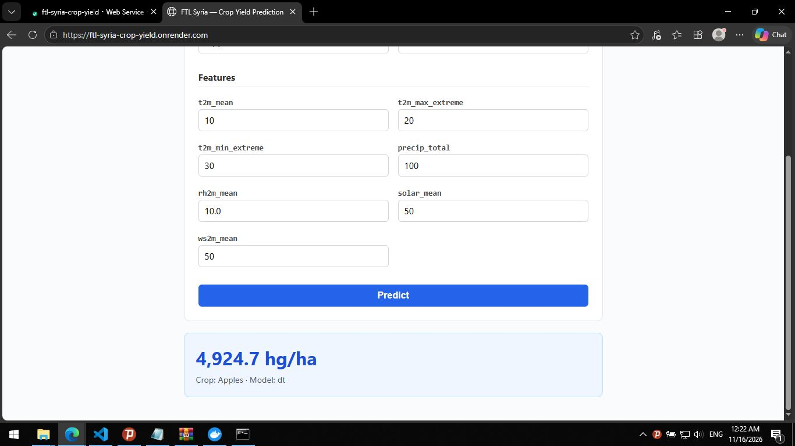

---

### 15.1 Repository layout for deployment

The production service runs from a dedicated **`deploy` orphan branch** that contains only the files required at runtime — no notebooks, no raw data, no training scripts. This keeps builds fast and the deploy image small.

Runtime files on the `deploy` branch:

```
deploy/
├── main.py                      # entry point: `from src.deploy.predict import app`
├── requirements-serve.txt       # runtime deps only
├── render.yaml                  # Render IaC config
├── config.yaml                  # optional; predict.py falls back to defaults
├── src/
│   ├── __init__.py
│   └── deploy/
│       ├── __init__.py          # ← REQUIRED for package import
│       └── predict.py           # FastAPI app (routes, model cache, HTML UI)
├── models/
│   ├── feature_schema.json      # crop list, feature list, model filenames
│   ├── training_summary.json    # optional; not read at runtime
│   ├── dt_*.pkl                 # 15 decision-tree models
│   └── xgb_*.pkl                # 15 XGBoost models
└── data/
    └── interim/
        └── train.csv            # optional; used only for UI input defaults
```

> **Note:** `main.py` uses `from src.deploy.predict import app`. The `src/` and `src/deploy/` directories **must** contain `__init__.py`, otherwise Render raises `ModuleNotFoundError: No module named 'src.deploy.predict'`.

---

### 15.2 Prerequisites

- A [Render](https://render.com) account (free tier is sufficient).
- The repository pushed to GitHub / GitLab / Bitbucket.
- A `deploy` branch containing the runtime files listed in §15.1.
- `.pkl` model files **not** excluded by `.gitignore`. Verify:

  ```bash
  git check-ignore -v models/dt_apples.pkl
  # (no output = not ignored, good)
  ```

---

### 15.3 Building the `deploy` branch (one-time setup)

The `deploy` branch is an **orphan branch** — it shares no history with `main`/`master`, so nothing from the full repo leaks in.

```bash
# 1. Start from a clean working tree
git switch main
git status                 # must be clean

# 2. Create the orphan branch
git switch --orphan deploy
git rm -rf .

# 3. Copy ONLY the runtime files into the repo root
#    (adjust source paths to your local layout)
cp main.py                   .
cp requirements-serve.txt    .
cp render.yaml               .
cp config.yaml               .
mkdir -p src/deploy
cp src/deploy/__init__.py    src/deploy/
cp src/deploy/predict.py     src/deploy/
cp src/__init__.py           src/
cp -r models/                models/
mkdir -p data/interim
cp data/interim/train.csv    data/interim/   # optional

# 4. Verify the tracked tree
git add -A
git ls-files

# 5. Commit and push
git commit -m "Deploy branch: runtime files for Render"
git push -u origin deploy
```

> ⚠️ **Windows case-sensitivity trap.** Windows filesystems are case-insensitive; Render runs Linux. Ensure the filename on disk is exactly `predict.py` (lowercase), not `Predict.py`, and that `src/deploy/__init__.py` exists on the branch — `git ls-files src/deploy` should list **both** files. Missing `__init__.py` is the #1 cause of `ModuleNotFoundError: No module named 'src.deploy.predict'`.

---

### 15.4 `render.yaml`

```yaml
services:
  - type: web
    name: crop-yield-api
    runtime: python
    branch: deploy
    buildCommand: pip install -r requirements-serve.txt
    startCommand: uvicorn main:app --host 0.0.0.0 --port $PORT
    healthCheckPath: /health
    autoDeploy: true
```

Key points:

- **`startCommand` must bind `0.0.0.0` and use `$PORT`.** Render injects `$PORT` at runtime; hardcoding a port causes *"No open ports detected"*.
- **`healthCheckPath`** points at `/health` (defined in `predict.py`), which returns `{"status":"ok","models_loaded":N}`. Render uses this to decide when the service is live.
- **`autoDeploy: true`** redeploys on every push to `deploy`. Set to `false` if you prefer manual deploys.
- **`branch: deploy`** — the critical line that makes Render build from the orphan branch, not `main`.

---

### 15.5 Creating the service on Render

1. Log in to Render → **New +** → **Web Service**.
2. Connect your Git provider and select the repository.
3. On the configuration form, set:

   | Field | Value |
   |---|---|
   | Name | `crop-yield-api` |
   | Region | Frankfurt (or nearest to your users) |
   | Branch | **`deploy`** |
   | Runtime | Python 3 |
   | Build Command | `pip install -r requirements-serve.txt` |
   | Start Command | `uvicorn main:app --host 0.0.0.0 --port $PORT` |
   | Health Check Path | `/health` |

4. If `render.yaml` is present at the repo root of the `deploy` branch, Render offers **"Use existing render.yaml"** — accept it; the fields above are filled automatically.

   

5. Click **Create Web Service**. Render will clone `deploy`, install dependencies, and start uvicorn. First build takes ~2–5 min.

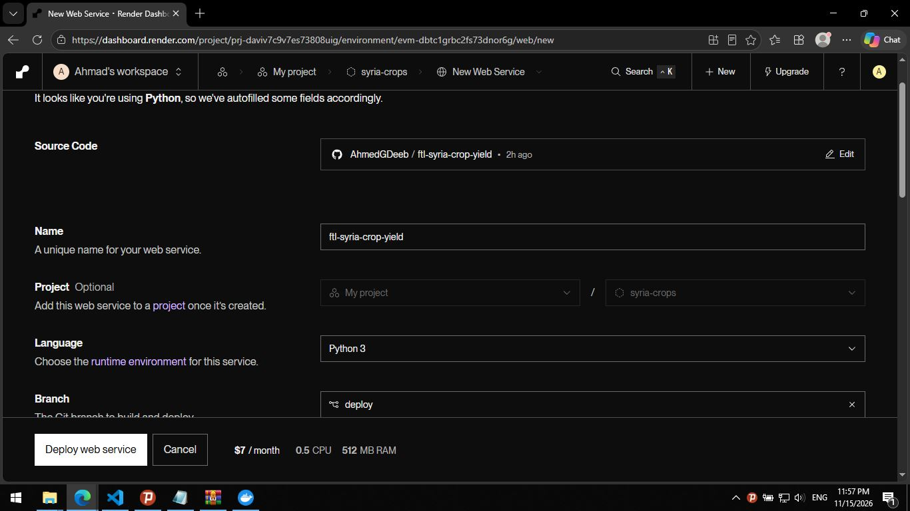
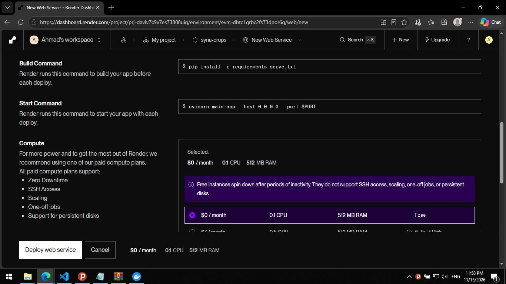
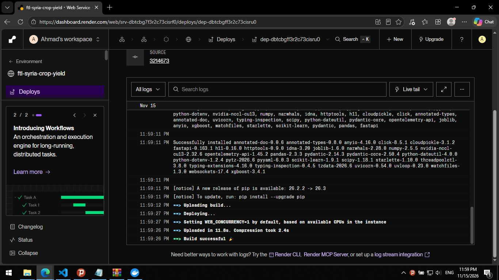
---

### 15.6 Deploying updates

Render pulls from Git on every push to the branch it watches. To ship a change:

```bash
git switch deploy
# edit files…
git add -A
git commit -m "Update predict.py"
git push origin deploy
```

Then watch the deploy in the dashboard:

- **Events** tab → *"Deploy started"* → *"Build successful"* → *"Deploy live"*.
- **Logs** tab → on success you should see:

  ```
  [startup] schema: /opt/render/project/src/models/feature_schema.json
  [startup] crops:  ['Apples', 'Barley', …]
  [startup] preloaded 30 models
  INFO:     Uvicorn running on http://0.0.0.0:10000
  ```


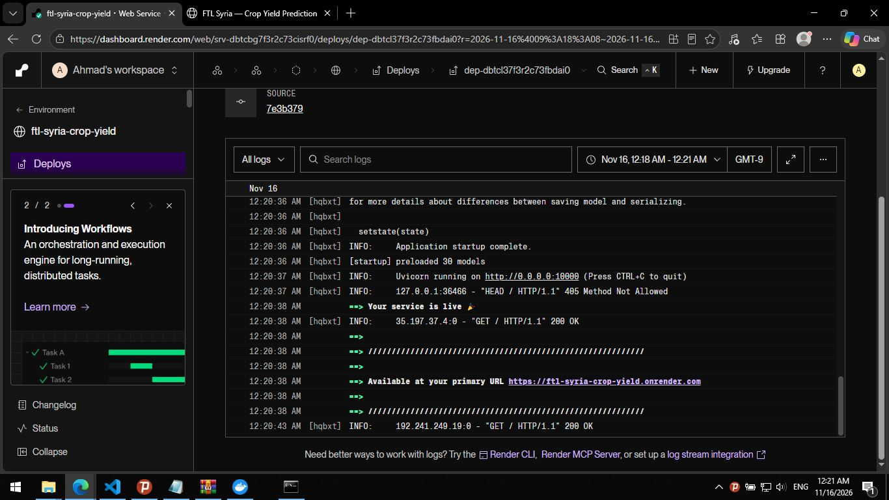
If Auto-Deploy is disabled (Settings → *Build & Deploy* → *Auto-Deploy*), trigger a deploy manually with **Manual Deploy → Deploy latest commit**.

---

### 15.7 Verifying the deployment

```bash
BASE=https://<your-service>.onrender.com

# 1. Liveness
curl -s $BASE/health
# → {"status":"ok","models_loaded":30}

# 2. HTML UI is up
curl -s -o /dev/null -w "%{http_code}\n" $BASE/
# → 200

# 3. Swagger UI
curl -s -o /dev/null -w "%{http_code}\n" $BASE/docs
# → 200

# 4. POST /predict  (shape matches PredictRequest in predict.py:
#    crop + model + features dict — NOT a list)
curl -s -X POST $BASE/predict \
  -H "Content-Type: application/json" \
  -d '{
        "crop": "Wheat",
        "model": "xgb",
        "features": {
          "t2m_mean": 15.2,
          "t2m_max_extreme": 35.0,
          "t2m_min_extreme": 2.1,
          "precip_total": 120.5,
          "rh2m_mean": 55.0,
          "solar_mean": 18.3,
          "ws2m_mean": 3.2
        }
      }'
# → {"crop":"Wheat","model":"xgb","predicted_yield_hg_ha":…, "input_features":{…}}
```

Expected responses:

| Request | Status | Meaning |
|---|---|---|
| `GET /` | 200 | HTML UI |
| `GET /health` | 200 | Service alive |
| `GET /docs` | 200 | Swagger UI |
| `GET /predict` | **405** | Correct — `/predict` is POST-only |
| `POST /predict` with valid body | 200 | Prediction |
| `POST /predict` with missing feature | 422 | Validation error from `predict.py` |
| `POST /predict` with unknown crop | 404 | Crop not in `feature_schema.json` |


---

### 15.8 Troubleshooting

The following are real failures observed during this deploy, with fixes.

#### `ModuleNotFoundError: No module named 'src.deploy.predict'`

The package import failed. Causes, in order of likelihood:

1. `src/deploy/__init__.py` is missing **on the `deploy` branch** (present locally but never committed).  
   Fix: `git add -f src/deploy/__init__.py src/deploy/predict.py && git commit && git push`.
2. `predict.py` was renamed or is `Predict.py` on a case-insensitive filesystem.  
   Fix: confirm with `git ls-files src/deploy | cat` — must show lowercase `predict.py`.
3. A `.gitignore` rule excludes `src/deploy/`.  
   Fix: `git check-ignore -v src/deploy/predict.py` to find the rule; narrow it or use `git add -f`.

#### `ModuleNotFoundError: No module named 'src.deploy'`

`src/` or `src/deploy/` isn't on the branch at all, or `src/__init__.py` is missing. Fix as above for both `__init__.py` files.

#### `RuntimeError: Missing /opt/render/project/src/models/feature_schema.json`

`models/` wasn't committed, or `predict.py`'s `PROJECT_ROOT` walks up the wrong number of levels. From `src/deploy/predict.py` the repo root is `.parent.parent.parent`, so:

```python
PROJECT_ROOT = Path(__file__).resolve().parent.parent.parent
MODELS_DIR   = PROJECT_ROOT / "models"
```

Confirm `git ls-files models` lists `feature_schema.json` and the `*.pkl` files.

#### `No open ports detected`

`startCommand` doesn't bind `$PORT` or doesn't use `--host 0.0.0.0`. Use exactly:

```bash
uvicorn main:app --host 0.0.0.0 --port $PORT
```

#### `GET /predict` returns `{"detail":"Method Not Allowed"}`

Not a bug — `/predict` only accepts `POST`. Use Swagger (`/docs`) or `curl -X POST` to test it. If you expected an **HTML form** and got 405/404, verify `main.py` is `from src.deploy.predict import app` (so `predict.py`'s `@app.get("/")` HTML route is registered), not a separate minimal app.

#### Service crashes on startup / OOM

`predict.py` calls `CACHE.preload_all()` in the `@app.on_event("startup")` handler, loading all 30 `.pkl` files. On Render's 512 MB free tier this can OOM. Options:

- Upgrade to the Starter plan (1 GB+), **or**
- Comment out `CACHE.preload_all()` in `predict.py` — models are then loaded lazily on first request per `(crop, model)` pair via `CACHE.get()`.

---

### 15.9 Costs and limits (free tier)

| Resource | Free tier | Notes |
|---|---|---|
| Instance hours | 750 / month | Service sleeps after 15 min idle |
| RAM | 512 MB | Likely too small for 30-model preload — see §15.8 |
| Bandwidth | 100 GB / month | Plenty for this API |
| Cold start | ~30–60 s | First request after idle is slow; consider a ping service |

For production, upgrade to **Starter** (1 GB RAM, always-on) to avoid cold starts and OOM.

---

### 15.10 Rollback

If a deploy breaks production:

1. **Render dashboard** → service → **Events** → find a previous *"Deploy live"* → click **Rollback to this deploy**.
2. Or revert the Git commit on `deploy` and push:

   ```bash
   git revert HEAD
   git push origin deploy
   ```

---

### 15.11 Local smoke test before pushing

Reproduce Render's behavior locally from the `deploy` branch root:

```bash
pip install -r requirements-serve.txt
uvicorn main:app --host 0.0.0.0 --port 9696
```

Then open `http://localhost:9696/` and `http://localhost:9696/docs`. If it starts here, it will start on Render — the only differences are `$PORT` injection and the 512 MB memory limit.

---

### 15.12 Deployment checklist

- [x] `deploy` branch exists and is pushed
- [x] `git ls-files src/deploy` shows both `__init__.py` and `predict.py` (lowercase)
- [x] `git ls-files models` shows `feature_schema.json` and all `*.pkl`
- [x] `git check-ignore -v models/*.pkl src/deploy/*` returns nothing
- [x] `render.yaml` present with `branch: deploy`, `$PORT`, `healthCheckPath: /health`
- [x] Render service branch set to `deploy`
- [x] Build succeeds → Events shows *"Deploy live"*
- [x] Logs show `[startup] preloaded N models`
- [x] `GET /health`, `GET /`, `GET /docs` return 200
- [x] `POST /predict` returns 200 with a numeric prediction

---

## 16. Troubleshooting

### `python: command not found` (macOS/Linux)

Use `python3` throughout, or alias it:

```bash
alias python=python3
```

### `dvc: command not found` inside `.venv`

Your venv was created before `install-deps` ran. Confirm:

```bash
python -m pip show dvc
```

If missing: `python -m pip install -r requirements.txt`.

### `[config] ... not found — using in-code defaults` at startup

`config.yaml` is missing or in the wrong directory. It must sit at the **project root**, next to `src/`. Verify with:

```bash
ls -la config.yaml    # macOS/Linux
dir config.yaml       # Windows
```

### `[config] failed to parse ...` at startup

`config.yaml` has a syntax error (usually a tab character instead of spaces). Run:

```bash
python -c "import yaml; yaml.safe_load(open('config.yaml'))"
```

The traceback points at the offending line.

### FAOSTAT `[ERROR] ... failed after 3 attempts`

Check network connectivity to `faostatservices.fao.org`. If the issue persists, the endpoint may be rate-limiting. Wait a few minutes and retry with `-f`. Confirm the API is up by visiting the URL in a browser.

### NASA `[WARN] 200 OK but body is not CSV` (FAOSTAT only)

FAOSTAT occasionally returns JSON on a legitimate request. The code retries automatically; if it fails all three attempts, the year's file is skipped. Re-run later with `-f`.

### `dvc add data/raw/` says "No changes to 'data/raw/'"

The data hasn't changed since the last `dvc add`. No action needed — the pointer is already current.

### `git push` fails with "large files detected"

A `.csv` slipped past `.gitignore`. Remove it from tracking:

```bash
git rm --cached data/raw/*.csv
git commit -m "chore(data): untrack CSVs (managed by DVC)"
```

### Cross-platform CRLF errors running `.sh` files

Files transferred from Windows carry CRLF line endings, which bash rejects. Fix:

```bash
sed -i 's/\r$//' *.sh
```

### `Permission denied` running `.sh` files

```bash
chmod +x create-schema.sh install-deps.sh track-dvc-git.sh
```

---